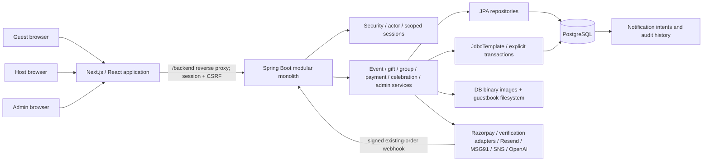
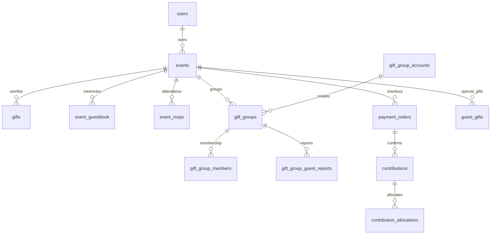

# Document 1 — Technical Design & Specification

**Growth and performance update — 6 November 2026:** [Current implementation and rollout](releases/2026-11-06_GROWTH_AND_PERFORMANCE.md) covers the public home/demo, guided creation in both views, mobile invitations, consented sharing previews, bounded dashboard insights, approved-wishes keepsakes, image delivery and admin controls. Current schema head is V107. This update supersedes older route/default descriptions for the changed screens; it does not certify production deployment or live payments.

**Localisation update:** [Platform localisation](releases/2026-11-02_LOCALIZATION.md) documents language hierarchy, all settings/fields/APIs, fallback, RTL, communication boundaries and validation evidence.

**Implementation update:** [2026-11-02 controlled rollout](releases/2026-11-02_CELEBRATIONS_AND_SAFEGUARDS.md) documents new family/office occasions, three-level grants, invitation-only publishing, arrival/calendar details, repeat drafts, approved-wishes keepsakes and production safeguards. Read this with the refreshed source catalogues.

**Application:** Gift Platform / Gift Invitation Studio. **Baseline:** the inspected working tree, including Flyway migrations through V107 and uncommitted application changes; not merely the committed revision. **Authority:** executable source and migrated schema win over earlier design notes. See [coverage and evidence](README.md), [machine-readable baseline](catalogue/backend-source.json), and [migration catalogue](MIGRATION_CATALOGUE.md). No production environment or customer data was inspected.

This document and its linked catalogues form one specification. Every discovered page/control declaration, API operation, schema object, configuration declaration and source guard is indexed. Formal product intent, runtime-generated fields, deployed infrastructure and unspecified response contracts cannot be certified as 100% complete from code alone. Those omissions are explicit in the final gap register in Document 3; they must not be silently treated as implemented defaults.

## 1. Executive summary

Gift Platform lets hosts create celebrations, publish QR-linked invitations, curate wishlists, collect contributions, organize guest/group gifts, receive RSVPs and wishes, and revisit guest photos/messages in a private memory album. Platform administrators control module access, verification policies, payment channels, invitation content, monetization and operational reporting.

Business objectives visible in the implementation are: make event gifting understandable; preserve guest privacy; separate planned gifts and self-reported transfers from confirmed payment facts; keep receiving accounts scoped to the correct event; support collective giving without mandatory guest registration; and give the host an event-centered operational workspace. Adoption, conversion, revenue and retention targets are not supplied.

Target users are event hosts, invitation guests, group creators, registered/approved group members, platform administrators and accounts submitting commercial placements. Merchant-provider operators, finance/support, incident response and compliance reviewers are operational stakeholders; separate application roles for those stakeholders are not implemented.

### 1.1 Roles and effective access

| Actor | Authentication / scope | Allowed work | Important limits |
| --- | --- | --- | --- |
| Anonymous invitation guest | Published invitation token; browser session where needed | View enabled public content, RSVP/wish/photo, individual gift, enabled manual payment instructions/reporting, permitted group contribution without registration | A public token is not ownership. Hidden/draft wishes, private amounts, contact details, delivery addresses and host APIs remain scoped. CSRF still applies to many public mutations. |
| CUSTOMER host | Spring Security session with a `GiftUserPrincipal` | Own profile, own celebrations/wishlist, event accounts, reports, guest moderation, QR/designs, commercial purchases, enabled album/AI features | UUID knowledge does not grant ownership. Event lifecycle, module grants, contact policies and provider gates apply independently. |
| PLATFORM_ADMIN | Authenticated principal carrying `ROLE_PLATFORM_ADMIN` | Platform/host/event controls, gallery administration, policies, commercial configuration, reports, audit | No role is proof of verified payment or a delivered notification. Admin APIs require role/actor checks and mutation CSRF. |
| Group creator | `gift_group_accounts` credentials plus event-scoped, page-bound session | Own group plan, invitations/member review, creator receiving accounts, guest contribution configuration, receipt acknowledgement, publication and fulfilment | Separate from a host login. `X-Group-Page-Id`, session idle timeout and credential epoch checks apply to creator operations. |
| Group member | Group-specific member credentials/session and approval state | Own member view, allowed contributions/history, permitted member list | One group's login does not authorize another group. Joining/invitation/contact policies can block contribution. |
| Individual guest gift owner | Private browser session for the event; no registration UI | Manage the gift created/selected in that session, private host address, tracking, linked contribution report | Internal attribution uses undisclosed random credentials. The browser session is the recovery boundary; cross-device transfer/recovery is not implemented. |
| Payment/webhook provider | Verified provider request/secret/signature, not a user session | Confirm existing provider transactions and deliver signed webhook events | Provider order/payment, amount, currency and idempotency binding are essential. Never trust browser-only success. |

The platform module set includes GROUP_GIFTING, GUEST_GIFTS, RSVP, GUEST_ATTENDANCE, WHATSAPP_SHARING, GUESTBOOK, SOCIAL_SHARING, MEMORY_ALBUM and AI_INVITATION. Guest-added gifts depend on group gifting eligibility. Albums and AI additionally require event enablement; both begin disabled. Database-backed grants do not provision API credits, send SMS, enable production payouts or enroll a merchant.

### 1.2 Architecture

The backend is one deployable process with domain packages, not independently deployed microservices. PostgreSQL is the transactional source of truth. JPA and direct JDBC coexist. Several critical state transitions use row locks, optimistic versions, advisory transaction locks, unique constraints and immutable-history triggers. No external queue, cache, shared session store, CDN or object-store implementation was identified in the inspected source.

The frontend is Next.js App Router with React client components, a shared host workspace and focused/general experience variants. The checked-in Next.js rewrite directs `/backend/:path*` to `http://localhost:8080/:path*`; this is a development topology, not a ready production multi-host proxy configuration. Design drafts can also live in browser localStorage. A saved browser draft is not a published event.

### 1.3 Technology and dependency baseline

| Layer | Source-supported baseline | Caveat |
| --- | --- | --- |
| Backend | Java source target 21; Spring Boot parent 4.1.1; Maven wrapper; Spring MVC/Security/Data JPA/JDBC/Flyway/Actuator | Resolved transitive Maven versions follow dependency management; do not infer them from omitted dependency versions. |
| Database | PostgreSQL; integration/export fixtures use PostgreSQL 17 | The production PostgreSQL version, HA configuration and extensions are not attested. |
| Frontend | Declared Next `^15.5.0`, React `^19.1.0`, TypeScript `^5.9.0`; lockfile resolves Next 15.5.27, React 19.3.0, TypeScript 5.9.3 in this snapshot | Use the lockfile and compatibility-test upgrades; ranges are not production pins. |
| Image tooling | Java ImageIO/ZXing; guestbook conversion invokes ImageMagick `magick` | HEIC/HEIF support depends on the deployed ImageMagick codecs and policies. |
| Tests | JUnit/Mockito/MockMvc/Testcontainers; Node test runner; TypeScript checking | No verified browser E2E, load benchmark or production acceptance report was provided. |

Full declared Maven and locked npm package inventories: [dependency catalogue](DEPENDENCY_CATALOGUE.md).

## 2. Functional specification by module

Every row identifies business purpose, roles, dependencies, surfaces, success and failure behavior. The [screen catalogue](SCREEN_CATALOGUE.md), [UI control catalogue](UI_CONTROLS.md), [API catalogue](API_CATALOGUE.md) and [guard catalogue](BUSINESS_RULE_CATALOGUE.md) supply the exhaustive source-level expansion.

| Feature | Purpose / user roles | Dependencies and screens | Success criteria | Failure / edge cases |
| --- | --- | --- | --- | --- |
| Host registration and login | Establish host identity; public applicant/CUSTOMER/admin login | Username/email/mobile/password rules, verification/registration policies, BCrypt, CSRF; `/register`, `/login`, `/host/account` | Account created; authenticated session established with actual role and rotated session identity | Duplicate identity, invalid credentials, unmet signup verification, CSRF failure, disabled delivery, unsupported role; no invented session/JWT. |
| Contact verification and recovery | Recover/identify credentials and prove contact ownership | Email/SMS adapters, scoped challenges, expiry/attempt limits, credential session epochs; verify/recovery/account screens | Correct unexpired scoped proof is consumed once; credential version change invalidates stale sessions | Wrong scope, reused/expired code, delivery uncertain/unavailable, policy disabled, account-enumeration risks, attempts exhausted. |
| Host workspace and experience | Present an event-centered dashboard with focused/general UI | Profile, own event list, runtime experience/modules; `/dashboard`, `/events`, event sidebar | Own events and eligible features displayed; failed loads expose retry/error state | No events, expired session, stale feature grant, inaccessible UUID, partial API failure. |
| Event lifecycle and addresses | Create a celebration and control public visibility; owner | Event validation, receiving-account publish readiness, optimistic version, public token; `/events/new`, `/events`, `/events/[id]` | DRAFT creation/update; allowed publication/unpublication/completion transitions; public invitation resolves only when allowed | Missing contact/venue fields, invalid PIN/mobile/email, incomplete linked account setup, invalid lifecycle, stale version/conflict, other host. |
| Delivery address | Allow direct gift shipment without exposing private details broadly | Event venue address or separate validated address; event forms and private individual/group address APIs | Default uses event address; separate address persists when selected; only selecting guest/creator reads private shipment address | Partial separate address, unauthorized guest, missing event, stale selection; carrier purchase/delivery is outside the app. |
| Wishlist and product metadata | Curate desired gifts and safe product images; owner | ACTIVE/PUBLIC gift state, priorities, target/funding values, bounded retailer fetching, images; `/gifts` | Valid gift saved to own event; public cards expose eligible public data; metadata/photo capture remains reviewable | Invalid amount/link/photo, retailer CAPTCHA/unreachable host, SSRF rejection, unavailable gift, optimistic conflict, premium entitlement denial. |
| Invitation editor, QR and gallery | Produce editable/scannable event stationery; host/admin assets | Real authenticated event QR, local templates, source-safe layout, premium entitlements; `/`, `/events/[id]/qr`, `/admin/invitation-assets` | Exactly one protected real QR; validated artwork; draft remains editable; assets respect access tier | QR absent, unsafe overlap, unsupported upload/size, unauthenticated protected image, wrong event/design, unpublished destination, local draft loss. |
| AI invitation design | Generate validated wording/palette/layout from selected event facts; enabled owner | Global/host/event AI grants, backend provider key/model/credits, request quota, structured output; editor dialog and admin details panels | Names/date/public venue remain source facts; generated copy stays bounded; real QR loads; applying changes only the editable draft | Exhausted credits, model/access error, local/provider rate limits, provider refusal/timeout, malformed output, revoked grant. No fake AI fallback or automatic publication. |
| Individual special gift | Let guests propose/select their own gift with private details | Guest-gifts grants, published invitation, private event browser session; Special Gift popup | Name/email/mobile/details and giving method saved; guest sees “Presented with love ♡”; host sees private details | Another guest wins selection, wrong browser/session/event, invalid HTTPS/link/contact/amount, gift count bound, missing address. |
| Link-and-contribution gift | Send the entered amount to host account and associate transfer report with gift | Eligible event-linked preferred host UPI/bank destination, saved owner/amount/contact, direct claim service | Guest pays externally, supplies transaction reference; one linked claim per gift; host sees pending verification | Unavailable method/destination, changed payload/idempotency conflict, duplicate reference, missing private session. Reporting does not prove funds received. |
| Direct purchase gift | Purchase externally and ship to private host address | Saved DIRECT_DELIVERY method/product link, private address and tracking endpoints | Guest can open retailer, view address, mark purchase and share tracking; host sees delivery status | No carrier integration or retailer purchase confirmation; invalid tracking, wrong session, external order failure; never claim shipping happened merely because a link was saved. |
| Host-wishlist group gift | Coordinate a group around an existing host gift | Existing per-card group entry, wishlist availability, creator session and reservation rules | Eligible gift details/goal populated; reservation respects identity/readiness and exclusivity | Another reservation, invisible/inactive gift, missing email verification where required; independent groups cannot reserve wishlist gifts. |
| Independent group collection | Let a separate group decide its own gift | V93 independent marker, general/link plan, metadata, creator accounts and guest contributions; Special Gift → Group | Choice is general collection or own gift link, never a duplicate host-wishlist list; group appears as cooking after creation | Unreadable link/manual entry, wrong creator, target validation, published plan edits blocked; collecting money and choosing later preserves history. |
| Group membership and contributions | Invite others with optional registration/login | Group readiness, join/access policies, member approval, payment settings BOTH/GUESTS_ONLY/MEMBERS_ONLY | Allowed guest can report without account; approved member sees private group progress/history; creator reviews members | Pending/rejected member, verification required, guest/member access mode disallows action, bad destination/reference, CSRF/page/session expiry. Logout is scoped and does not require invitation readiness. |
| Group receipt/publication/fulfilment | Track collection and present the completed gift deliberately | Receipt acknowledgement, confirmed-or-acknowledged progress, target and creator publication | Until gift publication guest sees Something is Cooking; after publication 100% Contributed; creator chooses purchase/tracking or transfer/completion | Self-report alone cannot fill progress; target missing/not reached; no gift name; invalid transition; published plan immutable. Receipt acknowledgement is not independent payment verification. |
| Provider contribution checkout | Create/confirm contribution orders | Server quote, amount/fees/revisions, Razorpay test credentials, server-bound idempotency, signature/provider data | Valid confirmed payment allocates exactly once to gift/wallet and stores the appropriate ledger facts | Wrong order/payment/currency/amount/signature, client-only success, duplicate webhook, stale quote, provider timeout/unknown result. Live merchant activation is not implemented by changing a label. |
| Receiving accounts and verification | Register encrypted host/group UPI/bank instructions and link them to events | AES-GCM/HMAC keys, masks, account status, event-scoped enable/preferred flags, verification adapters | Only eligible destination for the owning event is offered; sandbox and unverified data remain distinguished | Archived/revoked/failed destination, wrong host/event, missing QR/payload match, invalid encryption key, unavailable provider/entitlement. |
| Settlement and withdrawals | Present balances and record controlled requests; owner/internal services | Conditional settlement UI, verified linked banks, reservation/reconciliation safety services | Existing request interface records BLOCKED / LIVE_PAYOUTS_DISABLED and supports scoped cancellation/audit | Live payouts are false; no UI/provider transfer dispatch. A blocked request, reservation or fallback candidate is not a payout. |
| RSVPs | Record attendance and party size; public enabled guest/owner reports | RSVP grants, published token, per-event submission limit, unique guest email | One valid attendance response; host totals match saved values | Duplicate email, invalid YES size / NO or MAYBE nonzero size, malformed contact, unavailable draft/module, limit hit. |
| Guestbook and photos | Capture moderated wishes/photos; guest/owner | GUESTBOOK grant, mode AUTO/APPROVAL, file conversion/bounds and local storage | Approved wishes public; pending/hidden remain private; sanitized photo and its message saved | Bad upload/signature/size/codec, conversion/storage failure, moderation permission mismatch, rate limit. |
| Private event memory album | Turn guest photos/messages into a host keepsake | Platform/host/event album grant, owned guestbook/photo records; `/events/[id]/album` | Chronological photo and text slides, private photos, opt-in playback/fullscreen/thumbnails/paging; hidden wishes optional | Access disabled, another host, no memories, missing file, pagination/load failure; disabling access preserves records. |
| Thank-you and notifications | Customize acknowledgement content and inspect recorded activity | Event thank-you settings, renderer, outbox/notifications, contact availability; thank-you/notifications screens | Message/settings saved and relevant intents recorded idempotently; UI distinguishes pending from delivered | Missing channel/provider/recipient, template validation, duplicate processing, delivery uncertain. Manual claim outbox does not itself send email/SMS/WhatsApp. |
| Reporting and verification | Explain contributions without mixing financial states | Owner filters, pagination/date/search/gift filters, exports, provider/manual/group data; contributions/transactions | Report scope and totals match defined source states; guest contacts/amounts are private | Cross-host query, invalid filter/date range, request pending, export escaping/currency mistakes, stale verification. |
| Monetization and partnerships | Charge for defined platform access and manage disclosures | Stream/master switches, revisioned policies, offers/orders/entitlements/revenue, placement review and affiliate configuration | Reviewed provider-confirmed purchase grants access once; active approved placements/eligible affiliate redirects tracked | Stale offer, wrong buyer/resource, expired entitlement, moderation rejection, disabled stream; a click is not revenue and a statement is not provider-confirmed cash. |
| Administration and audit | Grant/revoke capabilities and inspect system facts | Admin role, CSRF, platform/host/event tables, revision controls, audit history; `/admin` tabs | Authorized changes apply and are audited; AI/album details are inspectable without secrets | Non-admin, stale revision, invalid module/target, missing grant/dependent module; no UI-only authorization. |

## 3. Screen, field, button and navigation contracts

The complete screen-by-screen route documentation is [SCREEN_CATALOGUE.md](SCREEN_CATALOGUE.md). It includes all 28 page routes, their route composition, access, navigation, pre/postconditions, wireframe sections, controls and actions. The following are also screens even though they have no independent route: AI designer dialog, Special Gift chooser/individual form, group creator workspace, checkout/QR dialog, image/gallery/editor tools, verification/recovery controls, placement purchase/moderation panels, album slideshow/fullscreen and admin details panels. Their fields/buttons are covered by [UI_CONTROLS.md](UI_CONTROLS.md) and their source conditions.

Each control catalogue entry records its label, HTML/control type, state binding, native validation, length/range/default declarations, allowed select values, visibility/editability conditions, submit/click/change actions, component API references, security notes and source location. A repeated database-driven dropdown is described by its control declaration and source collection, not by inventing future runtime options.

### 3.1 Verified field-to-API-to-database mapping examples

These concrete maps establish conventions; they do not assert that similarly named fields in every other component map identically. All database fields and API records are separately enumerated in the linked catalogues.

| Screen/domain field | API or model | Database target / transformation | Validation and visibility |
| --- | --- | --- | --- |
| Event title / occasion / date | EventRequest; owned event create/update | `events.title`, `occasion_type`, `event_date` | Server/DB length/state rules; dates are local calendar dates, not UTC instants. |
| Host displayed name | EventRequest hostName and event management | `events.host_display_name` | Not the same as authentication username or account full name. |
| Venue/contact fields | EventRequest and Event entity contact/address setters | `events.address_line1`, address city/state/postal/country and contact columns | Required publish/setup inputs and India PIN/contact validation; public venue for AI is explicitly editable. |
| Delivery same-as-event / separate address | EventRequest deliverySameAsEvent/deliveryAddress | `events.delivery_same_as_event` and `delivery_address_*` | Default true; false requires complete separate address; private delivery API access. |
| Wishlist name / description / URL / target | GiftRequest / gift management | `gifts` name/description/product URL/target amount | Gift target decimal rupees; payment/contribution interfaces typically convert rupees to integer paise. |
| Guest special gift identity/contact | IndividualGuestGiftController.Entry | `guest_gifts.guest_name`, guest_email, guest_mobile | Name/email/mobile required in new individual form; no public guest response exposes them. |
| Contribution amount / giving method | Entry.contributionPaise/givingMethod | `guest_gifts.contribution_paise`, giving_method | LINK_AND_CONTRIBUTION bounds ₹1–₹10,00,000; DIRECT_DELIVERY does not save that amount. |
| Host contribution transaction reference | HostContribution record and direct-transfer claim service | `guest_direct_transfer_claims` reference hash and gift-to-claim link | Method/destination/reference only supplied by payment form; saved amount/contact are derived server-side. |
| Group independent flag / collection plan | GroupContributionController.Setup and independent plan API | `gift_groups.independent_gift`, gift_name/description/link/target_paise | Omitted/null independent flag normalizes false; independent flag cannot accompany wishlist giftId. General collection can have no chosen gift yet. |
| Group receipt acknowledgement | Creator receipt API | Report's creator_received_at and progress views | Does not change reported payment into an independently VERIFIED financial posting. |
| Guest message / photo | WishRequest or multipart guestbook photo | `event_guestbook` text/status/photo_path | Required message/name, moderation state; private filesystem JPEG is served through scoped APIs. |
| Album/AI platform + host + event switches | Admin module/event settings APIs | platform module/host grant plus event-specific settings tables | All required gates must be true; disabled access does not erase drafts/memories. |
| AI style/tone/language/names/venue/time/personal message | AiInvitationService.Preferences | Not stored as prompt text in `invitation_ai_requests`; request metadata/status only | Bounded text, enums, ownership/module checks, provider availability and quota; resulting editable browser draft is distinct. |
| Account number/IFSC/UPI | Receiving-account request records | Encrypted account fields + masked display + HMAC fingerprints | Server-derived host/event scope; encryption/AAD/fingerprint checks; no secrets in client API config. |

### 3.2 Shared state behavior

Reads begin in loading state and should distinguish empty data from unavailable data. Mutations disable relevant controls, validate client input, use CSRF/session context, and only transition to success on an accepted backend response. Financial confirmation and notification delivery require their separate authoritative state. Refresh/retry must not duplicate non-idempotent writes. Exact per-component expressions, error/notice state and action references remain in the UI catalogue.

## 4. Business and domain invariants

### 4.1 Identity and tenancy

The authenticated principal supplies host identity; a client-provided host UUID is not trusted. Services/repositories scope events, gifts, accounts, reports and designs to the current host. Public invitation tokens identify eligible published events, not administrative ownership. Account recovery challenges bind identity kind, scope, contact and proof; expiry, attempt and replay checks apply. Host/admin, group creator, member and individual gift sessions are different authorization domains.

Passwords are BCrypt-hashed; the main encoder cost is 12. A six-digit PIN is a credential, not a numeric display preference; applicable policy and hash checks must be retained. Creator group sessions use a ten-minute idle timeout in current source and page ID/credential epoch checks. Do not assign that same duration to all host sessions without an explicit configured host-session policy.

Logout must clear only the intended session scope and must remain possible after invitation readiness is lost. Group member logout validates the invitation's event/group association, retains CSRF, clears that group's member/epoch attributes, and does not require an active invitation/receiving account. Missing/null `independentGift` must not cause binding failure before the authentication check.

### 4.2 Events and gifts

Event lifecycle states are DRAFT, PUBLISHED, COMPLETED and CANCELLED with transitions enforced by the entity/service; inspect the entity and tests before adding transitions. Published guest pages are not draft preview pages. Publish readiness requires valid event information and an eligible enabled/preferred receiving account actually linked to that event. A host's account being preferred elsewhere is insufficient. Optimistic versions/conflicts must not be resolved by blindly overwriting another user's edits.

Wishlist/public gift visibility and ACTIVE state determine contribution availability. A reservation hides/marks an unavailable gift according to the implemented invitation projection. Group plans and contribution snapshots preserve historical association when a chosen gift changes/releases. An independent group cannot reserve a host wishlist gift. Do not delete contribution history to reset a plan.

### 4.3 Money and payment state

Use integer paise for payment and transfer records. Do not use JavaScript floating point as a financial ledger. Convert a validated decimal rupee input to paise exactly once at the defined UI/API boundary. Gift target decimal columns and integer payment columns are different representations; reconcile using explicit conversion, never a guessed unit.

There are materially different facts: intended/planned gift amount; a guest's unverified transfer report; a creator's receipt acknowledgement; provider-verified contribution; ledger allocation; available/held/withdrawable settlement; and a blocked payout request. None implies the next automatically. Public recorded progress can include unverified reports where explicitly labelled; it must not be presented as independently received cash. Group progress can include creator-acknowledged receipts while their transfer verification status stays unverified.

Razorpay checkout paths in current code enforce test credential/response expectations. Production merchant enrollment/live mode is not established. Server quotes and provider amount/currency/order/payment validation precede confirmed allocation. Unique postings, signatures, idempotency and locked transitions prevent replay from becoming duplicate credit. Webhooks can complete existing valid orders independently of a browser remaining open.

Direct UPI/bank payment instructions resolve only eligible event-linked host destinations; independent group contribution instructions use the selected creator destinations. Individual special-gift contribution amounts/contacts come from the saved session-owned gift, not the subsequent payment request. A duplicate reference or changed payload under the same idempotency key is a conflict.

No refund endpoint was discovered. Refund policy, provider dispatch, approvals and accounting reversal orchestration are missing requirements, not a hidden completed workflow. Payout UI APIs, when configured, record blocked requests; `livePayoutsEnabled` is false. Internal reservation/reconciliation classes are safety scaffolding, not proof of a live withdrawal implementation.

### 4.4 Privacy, publication and moderation

Other guests see individual gift name/details and warm presentation text; they do not see contribution amount, private contact or tracking data. The host's owned reports include the applicable identity/amount/progress/tracking information even before group gift publication. Group cards remain “Something is Cooking 🍳” until explicit creator gift publication. Only fully funded groups with required gift details can publish as “100% Contributed”. Public publication is distinct from opening an invitation or paying a group coordination fee.

AUTO guestbook wishes can be publicly approved on submission; APPROVAL mode leaves them pending. Hidden wishes do not belong in public projections. A private host album can include pending wishes and optionally hidden wishes without changing public moderation. Album photo access uses its own host/event grant, so disabling guestbook submission need not destroy the host's memories.

### 4.5 Notifications, audit and reports

A PENDING notification/outbox row is an intent, not a delivery receipt. Verification/recovery email/SMS adapters and contribution thank-you intents have different transport/status behavior. Retries must not falsely record a message as sent. Financial reports distinguish manual/group pending amounts from provider-verified revenue, fees, allocations and partner-reported statements.

Sensitive actions use server-side actor checks and audits. Immutable activity/history triggers must not be bypassed for convenience. Audit retention, deletion policy and access review frequency require a production-approved policy. Exported CSV must preserve quoting/escaping and clear money units; a file export does not authorize its redistribution.

Every discovered source guard, exact failure and declarative validation is expanded in [BUSINESS_RULE_CATALOGUE.md](BUSINESS_RULE_CATALOGUE.md). Exact SQL constraints/triggers are in [DATABASE_CATALOGUE.md](DATABASE_CATALOGUE.md).

## 5. Database design and lifecycle

The fresh V97 schema has 97 base tables (including Flyway infrastructure) and 3 views. The physical inventory includes 849 columns across tables/views, 496 constraints, 231 indexes, 159 foreign-key column relationships, 25 user/application triggers and 11 schema routines. Complete per-table column types, SQL defaults, nullability, constraints, indexes, consumers, view definitions, triggers and routines are in [DATABASE_CATALOGUE.md](DATABASE_CATALOGUE.md).

- [Complete ER diagram source](complete-er.mmd): all base tables and columns with FK associations. The parent-child glyph is navigational, not a substitute for each column's nullable/unique rules.
- [Relationship matrix](RELATIONSHIP_MATRIX.md): exact FK column pairs and ON DELETE/UPDATE behavior, including composite relationships.
- [Migration catalogue](MIGRATION_CATALOGUE.md): all V1–V97 inputs with source hashes and altered/created object names.

The small diagram is a conceptual navigation map; exact FKs/cardinality/delete rules are in the full physical export, not inferred from these labels.

Lifecycle distinctions: drafts and media may be edited under owner rules; immutable financial/activity records are not ordinary CRUD documents; credential/OTP proofs expire and are consumed; event/module disablement normally revokes access without deleting content; commercial entitlements have durations and snapshots; self-reported transfers can remain pending. No comprehensive automated purge/archive/erasure scheduler or approved retention schedule was established. Document 3 proposes a policy process and names the production gaps; legal/financial retention periods must not be invented.

## 6. API architecture and contracts

[API_CATALOGUE.md](API_CATALOGUE.md) enumerates all 290 discovered source-declared operation mappings, including 34 not registered under the export configuration. It records the actual 256 runtime handler registrations separately. [API_MODELS.md](API_MODELS.md) lists reflected request/response records, class fields, annotations and enum values from registered and conditional controllers. Examples are schema illustrations, not claims that invented IDs or enum placeholders produce a valid business operation.

### 6.1 Common request patterns

1. Frontend same-origin requests go to `/backend/api/...`; the reverse proxy removes `/backend`. Backend catalogue URLs start `/api/...`.
2. Cookie sessions, not a documented JWT bearer scheme, authenticate hosts/admins. Bootstrap `GET /api/auth/csrf` and echo cookie token as `X-XSRF-TOKEN` on applicable writes.
3. Creator group requests include their page-bound `X-Group-Page-Id`; group member and individual browser session scopes differ. A host cookie must not be substituted for creator authority.
4. JSON uses declared record fields. Multipart uploads use the browser-generated boundary; do not manually set a mismatched multipart Content-Type.
5. Binary image/download endpoints require their negotiated content type and privacy checks; JSON assumptions do not apply to PNG/JPEG/CSV.
6. Request idempotency/revision fields, where declared, are part of the semantic contract. Reusing a key with different intent must fail; starting a new key after an uncertain payment can duplicate the financial intent.

### 6.2 Error families and retries

400 commonly means malformed JSON or rejected field/guard; 401 absent/expired applicable authentication; 403 role/CSRF policy; 404 missing or deliberately concealed resource/feature; 409 state/version/idempotency conflict; 413/415 upload size/type; 422 AI refusal; 429 application/provider limits. AI provider exhaustion is categorized as 402 with safe code AI_CREDITS_EXHAUSTED, not a recommendation to retry immediately. Safe provider configuration/throttling/connection/invalid-output codes distinguish the root failure without exposing credentials or raw upstream errors.

There is no single global stable error envelope. Some controllers emit ProblemDetail, others framework errors or explicit maps. Exact per-endpoint body guarantees require contract tests/OpenAPI completion; this is a documented gap. Never parse every failure as a successful data model.

No universal API rate/timeout/retry policy exists. Per-feature rate limiters, DB quotas, in-memory windows, provider timeouts and upload execution limits are authoritative at their source declarations. Most mutations must not be retried blindly; direct claims/provider confirmation/webhooks have their own idempotency semantics. The profile-name CSRF-cookie retry helper is not permission to replay event creation or payment requests.

### Framework and implicit HTTP endpoints

The API catalogue counts source-declared application operations. Spring additionally serves minimal GET health paths `/actuator/health`, `/actuator/health/liveness` and `/actuator/health/readiness` (public; probe groups configured in production), and admin-only `/actuator/metrics` / `/actuator/metrics/{name}` when exposed. Production health responses hide component/details; readiness includes DB connectivity. `/error` is framework error dispatch, not a business API. Spring can supply implicit HEAD for GET handlers and OPTIONS method discovery; these do not bypass authentication, CSRF or owner/module checks. See [operations tooling](../../ops/README.md) for release/profile requirements.

## 7. External integrations and storage

| Integration | Current implementation | Authentication / processing | Error handling / production boundary |
| --- | --- | --- | --- |
| Razorpay | Contribution checkout, confirmation, signed webhook and commercial purchases | Backend secret/public-key pairing, request quotes, provider order/payment validation; browser checkout is followed by server confirmation | Current paths enforce test-mode expectations; live merchant/account/routing approval and production validation remain go-live prerequisites. |
| Direct UPI/QR | Event-linked host and group-creator receiving instructions | Stored encrypted identifiers/QR payload checks; guest uses UPI app, returns transaction reference | Manual report is unverified; wrong/disabled/unlinked destination rejected. QR payload matching is not proof of account ownership or receipt. |
| Direct bank transfer | Scoped masked/unmasked eligible recipient details and manual report | Host/group ownership and selected destination checks; bank transfer occurs externally | Not automatic bank reconciliation; UTR submission is not settlement confirmation. |
| RazorpayX verification | Configurable verification scaffolding/interpretation | Explicit enabled/key/source account configuration and request binding | Safe defaults/unavailable paths; sandbox success cannot assert production beneficiary validity. Not a live payout dispatch implementation. |
| Cashfree Secure ID | Sandbox adapter/gates and verification attempts | Explicit sandbox credentials/entitlement/provider schema requirements | Production approval/schema and account-name matching need evidence; no automatic activation. |
| Resend | Verification/recovery email adapter | Server-only API key and configured sender; HTTP response controls delivery outcome | Provider not configured/unavailable/timeout must not become a fake verification success. Sender domain/SPF/DKIM/DMARC and production deliverability are operator setup. |
| MSG91 | Selectable OTP SMS adapter | Server key, template and expiry settings | Carrier/template/region entitlement and real delivery testing are not established by a stored configuration. |
| AWS SNS | Phone-OTP SMS implementation when selected | AWS SDK credential chain, region/sender/type settings | SMS simulator/disabled sender is distinct; cost/delivery/regional setup must be approved externally. |
| WhatsApp/social | Invitation share links / user-initiated sharing | User opens sharing destination/client | No implemented WhatsApp Business message transport or push notification service was identified. |
| OpenAI | Responses API, strict invitation blueprint, bounded copy and safe error categories | Backend key/model; allowed event facts/preferences only; API credits required | No automatic top-up. Observed exhausted-credit diagnosis is historical evidence, not a current balance monitor. Granting host/event access does not fund API calls. |
| Retailer metadata/images | Public HTTPS fetch, bounded requests, redirect/address validation, product parsing | No arbitrary internal network destinations; CAPTCHA/unsupported pages can fall back to manual entry | Do not relax SSRF checks to fix one retailer. No guaranteed merchant product API contract or price freshness SLA. |
| Storage | Gallery and some gift/QR image binaries in PostgreSQL; normalized guestbook JPEGs on local/private filesystem; browser drafts | Owner/feature-gated media APIs, filename/path checks and image processing; refer to schema for binary columns | No S3/CDN/shared-volume adapter or off-host media backup was verified. DB backup alone does not protect guestbook files or localStorage drafts. |

Setup values, environment names and observed safe defaults: [CONFIGURATION_CATALOGUE.md](CONFIGURATION_CATALOGUE.md). Provider callback/webhook/API routes: [API_CATALOGUE.md](API_CATALOGUE.md).

## 8. Security architecture

Authentication uses `HttpSessionSecurityContextRepository`, session creation IF_REQUIRED and session-ID change on login. The main password encoder is BCrypt(12). `AuthResponse` contains user ID/email/role; it does not establish a JWT flow. No JWT issuance/refresh/revocation architecture was found; do not add a bearer token to examples or describe JWT rotation as implemented.

Authorization is layered: Spring route filters, actor context, controller/service owner checks, invitation publication/module eligibility, group/individual session scope, DB constraints and locked transitions. Features are checked on the backend; hidden buttons are convenience, not security. Session credential epochs invalidate older sessions after credential changes. Verification/recovery proofs are scoped, hashed and expiry/attempt checked.

CSRF uses an HTTP-readable token cookie plus header echo for applicable writes; the authentication session cookie is separate. The signature-verified Razorpay webhook and specified RSVP/wish/photo public submission routes are explicit CSRF exceptions with their own validation/limits. Their exception must not be extended to arbitrary public payments or group/account changes. Admin/metrics endpoints remain restricted.

Receiving-account values use AES/GCM/NoPadding with authenticated context binding and HmacSHA256 fingerprints; the encryption and fingerprint keys are separate configuration requirements. Wrong scope/key must fail rather than return plaintext garbage. Store keys outside source and keep old decrypting material available during an approved migration/rotation; no complete key-version rotation process is established.

OWASP-related controls visible in code include parameterized SQL for request values, React escaping, owner checks, credential hashing, scoped challenges, upload type/size/normalization checks, SSRF-resistant retailer fetching, CSRF, signature checks, rate limits and audit records. This is not an OWASP certification or a complete penetration-test report. Production TLS/cookie/header/CORS/forwarded-proxy/WAF/security-testing evidence is in the gap register, not assumed deployed.

The DB snapshot has no RLS policies and does not prove production DB role/network/at-rest controls. Actor scoping must remain correct even when a table lacks a composite FK. Raw secrets, OTPs, bank values, prompts and provider response bodies must not enter logs or admin detail responses. The documentation export deliberately excludes live rows and redacts configuration secrets.

## 9. Traceability and change ownership

For a feature change: update the page/component action and its request model; validate source guards and DB constraints; preserve event/host/session scope; add a forward migration when required; cover failure and replay behavior; update relevant journeys, APIs, configuration, tests and production gaps. Changes to payment recognition, publication, payout dispatch, verification ownership or delivery status require finance/security review criteria to be defined before production activation.

Rebuild commands and validation workflow are in [Document 3](03_PRODUCTION_OPERATIONS.md) and [documentation tooling](tooling/README.md). The catalogues are reproducible snapshots; regenerate after code/migration changes rather than editing generated field/index/API tables by hand.

## Growth experience architecture and controls

The new public discovery routes are `/` and `/demo`; the authenticated general-purpose designer is `/studio`. Public invitations use a server metadata wrapper and the existing client experience. A shared `GrowthProvider` reads nonsecret, no-store flags and refreshes on focus/visibility/broadcast without blocking unrelated page content. Admin saves use versioned optimistic concurrency and audit records. Server gates independently protect insights, rich previews, keepsakes and analytics writes.

Migration V107 introduces platform growth flags and revision metadata, two opt-in event sharing fields and a reusable thumbnail column. Private/public projections are explicit: preview services receive only title/occasion/date; keepsakes receive only approved guestbook names/messages with 20-row pagination. Private album media, contacts, RSVP identities and payment records are excluded. The event must remain in an eligible state and the underlying Guestbook permission remains authoritative.

See the [release contract](releases/2026-11-06_GROWTH_AND_PERFORMANCE.md#api-contracts) for all new operations, environment variables, errors, defaults, privacy rules and compatibility limits. Existing full-list API contracts remain compatible; the dashboard summary is bounded independently.
