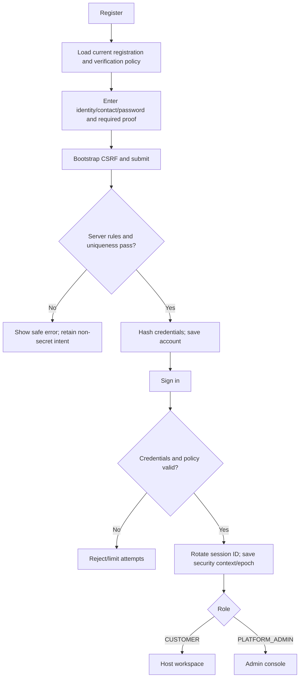
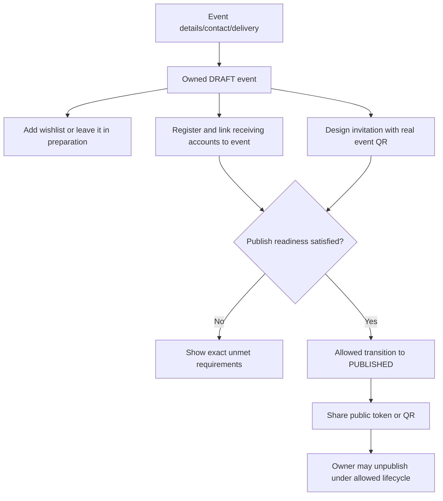
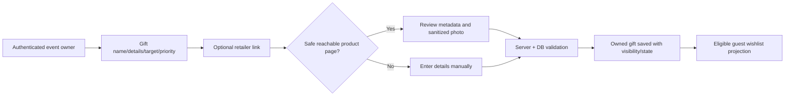
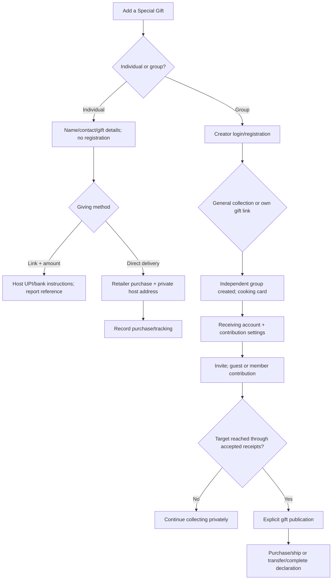
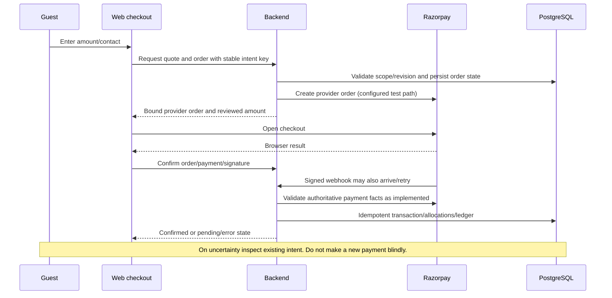
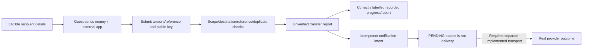
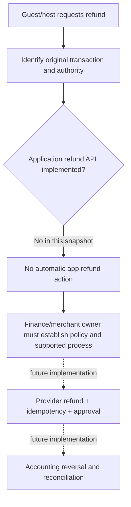
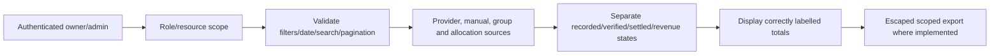
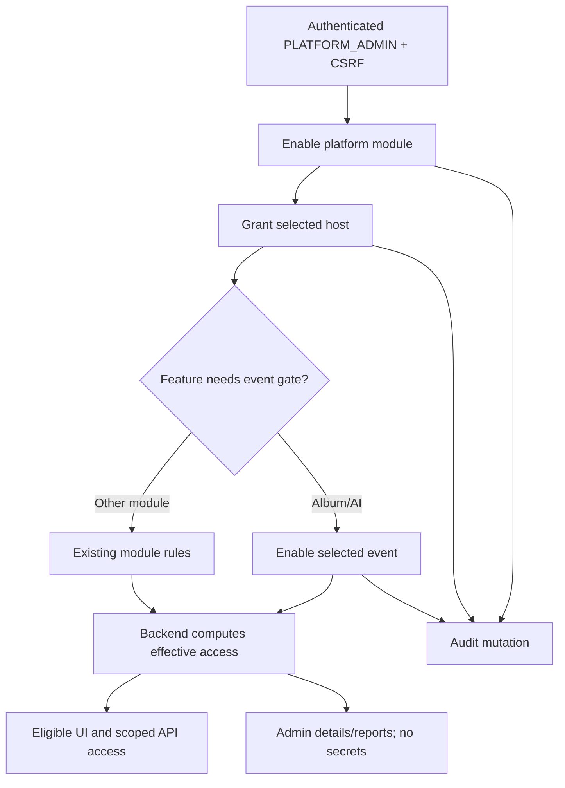
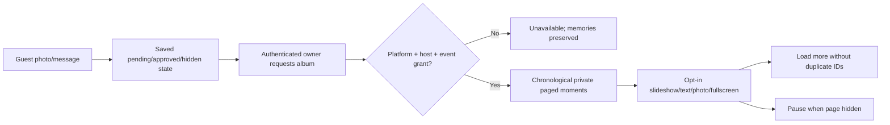

# Document 2 — Application Flow Guide

Use this guide with the [technical specification](01_TECHNICAL_SPECIFICATION.md), [complete screen catalogue](SCREEN_CATALOGUE.md), [control catalogue](UI_CONTROLS.md) and [API catalogue](API_CATALOGUE.md). The route catalogue covers all 27 page routes and their shared/dynamic component composition. Named dialogs, modals and alternate tabs are covered by their control declarations even when they do not have standalone URLs.

A “success” below means the specific step succeeded; it never automatically means paid, verified, published, delivered or shipped. Unavailable/conditional functionality is explicitly labelled. For every journey, inspect the operation's request model and exact guards before changing validation or examples.

## 1. Guest journeys

### 1.1 Open an invitation and decide how to participate

| Step / screen | Guest action | Validation and backend work | API/data/notification effect | Success / failure state |
| --- | --- | --- | --- | --- |
| Shared link / scanned QR → `/e/[token]` | Open event | Resolve public token and PUBLISHED event; load eligible public gift projection/modules | Public event/features/progress APIs read event/gifts/reports; affiliate links resolve server-side | Event/host/date/note/wishlist appear. Invalid/private/unpublished token becomes unavailable, not an owner preview. |
| Public invitation | Inspect wishlist, retailer, group or celebration option | ACTIVE/PUBLIC gift, group reservation and contribution-enabled flag; current channels/features | Reads eligible gifts; affiliate redirect may record a click | Eligible action opens checkout; held gift gets a gentle unavailable status; unverified totals retain their label. |
| Public invitation sharing | Open WhatsApp/social/share action where enabled | Module and browser capability | User-initiated share link; not an automatic business-message send | Link/share client opens or browser copy failure is reported. No delivery receipt is invented. |
| Participation | Choose contribute, special gift, RSVP or guestbook | Each choice uses a different session/validation boundary | Continue the appropriate journey below | One choice does not silently register a host or publish a group gift. |

### 1.2 Give toward a wishlist gift or the celebration

| Step | User input/action | Server authority | Data changes / notifications | Failure and recovery |
| --- | --- | --- | --- | --- |
| Contribution popup | Amount/name; optional contact where the existing checkout permits | Validated amount bounds, event/gift binding, channel control; display unit is rupees, request unit paise | No payment simply from entering an amount | Invalid amount/name or unavailable destination stays in the form. |
| Provider checkout | Choose enabled Razorpay path | Obtain event context and server fee quote; submit accepted quote totals and a buyer-intent idempotency key | payment_orders / quote/provider order metadata | Stale quote → refresh; network uncertainty → inspect existing order rather than inventing a new intent. Existing code remains test-mode restricted. |
| Provider modal | Pay or cancel | Browser result alone is not authoritative; server validates signature/order/payment/currency/amount | Confirmation transaction records provider payment, contribution/allocation/ledger effects exactly once | Cancellation preserves draft; confirmation uncertainty shows pending guidance and payment ID, not a second blind charge. |
| Signed webhook | No guest action | Verify signature and match an existing transaction/order; handle duplicate delivery | Webhook history and idempotent confirmation; notifications recorded as designed | Bad signature rejected; duplicate retries cannot duplicate credit; missing/invalid association must not create arbitrary contributions. |
| Direct UPI/bank option | View host details, transfer externally, enter transaction ID/UTR | Destination must be eligible, host-owned and enabled/preferred for that event; reference format/uniqueness and idempotency enforced | guest_direct_transfer_claims and display allocations/intents; manual notification outbox when applicable | Wrong destination/replay/reference → explicit error. Report success is AWAITING_VERIFICATION, not confirmed receipt. |
| Receipt/report | Read acknowledgement | Use the correct state family | Host/private report reflects source status; public progress remains appropriately labelled | Contact host with stable reference/payment ID; do not resubmit with a new key after an uncertain result. |

### 1.3 Add an individual special gift

1. From the invitation, select **Add a Special Gift**. The first popup asks Individual Gift or Group Gift; choosing Individual opens the details form without account registration/group creation.
2. Enter name, email and mobile. Add a new gift or select an available guest-added gift, then supply gift name and a product URL or description. These map to the session-owned `guest_gifts` record; contacts and amount remain private to the owner/host.
3. Choose **share a gift link and contribute to the host** or **purchase and deliver directly**. Native validation is supplemented by request/service/DB validation; unavailable gifts cannot be claimed twice.
4. Link-and-contribution requires a valid rupee amount; the request saves integer paise. Continue to the host's eligible UPI/bank instructions. The subsequent contribution request supplies destination/method/reference only: saved amount and contact values are derived server-side. A stable gift/owner key prevents retries from creating a second linked contribution claim. Other guests see the gift with **Presented with love ♡**, never the private amount/reference/contact.
5. Direct delivery requires the product URL and omits the monetary contribution amount. The saved guest owner can open the retailer, read the private host delivery address, mark the gift purchased and later share tracking. The app records those declarations; it does not charge the retailer, book a carrier or verify shipment automatically.
6. The host's gift report shows the planned gift, giving method, identity/contact, applicable amount, payment report status and delivery/tracking. The guest may return in the same browser session to manage it. Cross-device session recovery is not implemented.
7. Validation/concurrency/session/provider/storage errors remain visible and do not turn into fake success. A backend timeout after a write requires checking the existing private list/report before creating another gift.

### 1.4 Create an independent group gift

| Step / surface | Action and validation | API/data processing | Next success state / alternate path |
| --- | --- | --- | --- |
| Special Gift chooser | Choose Group Gift | Open creator sign-in/registration, not the individual form | Authenticate within the event scope; registration/contact policies still apply. |
| Group setup | Enter group name, creator name/mobile and optional description | Server derives creator from page-bound session; duplicate creator-group and text/contact rules | Select one of the independent collection plans. |
| General collection | Choose our gift later; optional goal | Save independent flag with no host wishlist association | Group can collect and later edit its own gift plan; no host wishlist catalogue is shown in this flow. |
| Own gift link | Paste HTTPS product link; fetch/review metadata | Bounded public retailer fetch; fill name/description and INR goal when recognized | Metadata is editable; unreadable/CAPTCHA/non-product link requires manual details. Foreign currency is not silently converted. |
| Create group | Submit validated setup | gift_groups row; independent group/wishlist integrity constraint; creator identity checks | Card is listed on invitation as Something is Cooking. Creating does not equal fully funded or published. |
| Receiving accounts | Add/enable creator UPI or bank destination; manage QR | Encrypted destination storage, masks, verification states and permissions | Choose account(s) and access mode under guest contribution settings. |
| Contribution settings | Suggested amount optional; select guest account(s); enable manual instructions; BOTH/GUESTS_ONLY/MEMBERS_ONLY | Creator-scoped settings validation; account ownership/enabled/status checks | Invitation readiness and any coordination fee/contact policy must also permit the public group page. |
| Invite friends | Open/copy the group link | Group route checks event/group/readiness; no public individual progress/amount list | Friends contribute without registration or choose join/member sign-in as permitted. |
| Collect / acknowledge | Members/guests report transfers; creator acknowledges receipt when actually received | Separate reported and acknowledged/verified totals, preserved transaction history | Creator/member-private progress; acknowledgement does not create independent financial verification. |
| Choose gift later | Update the independent gift plan | Creator lock/ownership; reject host wishlist reservation and post-publication edits | Contributions/history remain; goal/details can be supplied before publication. |
| Publish gift | Explicit publish after target reached and required name exists | gift_published_at distinct from invitation/collection status | Guest and host status becomes 100% Contributed; amounts/contacts remain private to their allowed roles. |
| Fulfil | Purchase and tracking, or transfer to host, then complete | Full-funding guard and allowed fulfilment transitions | Actual purchase/transfer happens outside these declaration APIs; no invented carrier or payout confirmation. |

The separate group entry on each **host wishlist card** retains its existing wishlist selection/reservation flow. It must not be conflated with the independent group collection described above.

### 1.5 Contribute to a group without registration

Open `/groups/[token]/[groupId]` and select the contribution view. The invitation must be accessible and guest access allowed. Enter guest identity/contact, amount, selected creator destination and transfer reference; use the external banking/UPI process before reporting. The server validates available method, account binding, reference, amount, submission key and contribution access mode, then records an unverified report. Completion acknowledges submission only. A guest has no general permission to list member contacts, other contributions, creator private activity or progress.

### 1.6 Join/sign in as a group member

Use the group's Join / Member sign-in view. Depending on policy, joining is open/approval-based or invitation-only. Supply the required scoped name/username, password, mobile, optional/policy-required email and PIN fields. Approval/contact verification can be required before member contribution. Member login/session is separate from creator and host sessions. Approved members may see private group progress and an allowed member list, and may report their own contributions/history. Rejected/pending/wrong-scope/expired credentials do not unlock contribution. Member sign-out clears only that group's member and epoch values, requires CSRF and validates event/group association, but does not require an active contribution invitation/receiving account.

### 1.7 RSVP, wishes and photos

RSVP collects name/email/attendance and party size. YES requires the defined positive size range; NO/MAYBE must not carry an attending party count. Duplicate scoped email or submission limits produce an explicit failure. The host receives saved response/summary facts, not an automatic notification transport guarantee.

Guestbook requires name/message and optionally a supported image. The image pipeline validates file signature/size, converts/strips/orients/resizes and stores a private normalized JPEG plus its DB reference. Conversion uses ImageMagick with process/resource/time bounds. A file failure must not publish unsanitized bytes. AUTO mode can make the wish publicly approved; APPROVAL mode leaves it pending. Only approved wishes/photos belong on the public invitation. The host can moderate and later enjoy the same content privately in the memory album; album inclusion does not publish hidden content.

## 2. Host journeys

### 2.1 Registration, account and recovery

Start at `/register`, validate the visible account inputs and any enabled signup proof, then create the account with CSRF. Sign in at `/login`, let the server establish role/session and route to the safe host/admin destination. Profile display name is editable at `/host/account`; it is not the same as the login identifier. Contact ownership and password/PIN/email recovery flows use scoped proofs, current policies and session-version invalidation. Disabled/unconfigured communication providers, expired/reused proof and changed contacts must remain distinct from success. Recovery pages must not be treated as unauthenticated access to account details.

### 2.2 Create and publish a celebration

1. Open `/events/new` or the applicable event-creation surface in `/events`; supply title/occasion/date, host display name, venue/contact and delivery preference.
2. Client validation catches basic required/formats; event management validates again, derives owner from principal, and inserts DRAFT data with version/state invariants.
3. Add gifts through `/gifts?eventId=...`, entering target/value/priority/description/link or fetching reviewed retailer metadata/images. A failed lookup does not require abandoning manual entry.
4. Add host UPI/bank profiles, link eligible ones to this particular event, enable them and select the required preferred destination. Sandbox registration/QR matching alone is not provider-confirmed account ownership.
5. Design the invitation/QR. Load the real event QR; source-safe geometry prevents covering its protected area. Gallery entitlement, image validation and QR identity remain checked.
6. If AI is enabled platform/host/event-wise, open the AI details form. Review supplied names/public venue/date/time/language/style/tone/message. A provider failure leaves the current design unchanged; exhausted API credits require administrator action. Applying a valid design changes the editable draft, not event publication.
7. Review the owner-only preview and publish only when readiness passes. The public token then becomes usable for guests. Unpublication temporarily makes shared public links unavailable; do not silently substitute an owner-preview URL.
8. Later completion/cancellation follow entity transitions; do not directly edit lifecycle columns to skip guards.

### 2.3 Operate the event

Use Guests & responses to inspect RSVP counts and approve/hide wishes. Use Contributions for source-aware private reports/exports, Transactions for implemented payment verification, Receiving accounts for event bindings, Notifications for recorded activity and Thank-you cards for acknowledgement content. Filters, search/pagination and export are part of the specific report contract; total recorded contributions are not automatically a withdrawable bank balance.

Receiving-account changes must never make another event's destination active by implication. Gift/collection reports preserve snapshots/history when a group changes its plan. Uncertain transfer status is a support/reconciliation matter; do not “fix” it by setting a label to confirmed.

### 2.4 Remember the event

When platform, host and event Memory album grants are true, open the event's album card/sidebar link. Load chronological photo/message entries, with pending wishes private and hidden wishes excluded by default. Start playback explicitly; use previous/next, speed, fullscreen or thumbnails. Long wishes get reading time; changing page visibility pauses playback. More pages load without duplicating overlapping IDs. A missing image preserves the accompanying message/fallback. The album remains owner-only even if the public invitation exists; an album grant does not grant public photo access. Disabling guestbook submission can leave the private album readable while its own grants remain enabled.

### 2.5 Withdrawals and settlement — explicitly limited

Conditional settlement APIs can display available/held/withdrawable values and eligible bank candidates. The implemented request facade records BLOCKED / LIVE_PAYOUTS_DISABLED, does not dispatch money and can support scoped cancellation. Internal reservations and reconciliation observations are not a production withdrawal product. If the feature is disabled, there may be no registered settlement API at all. Production payout onboarding, approval, dispatch, authoritative provider events, accounting settlement and reconciliation/failure ownership are missing launch gates.

### 2.6 Commercial access and placements

Review current server offer/price/revision for enabled host plans, premium invitation assets, group coordination, vendor listings or sponsored recommendations. Submit buyer/resource-bound idempotent checkout; confirmed test-provider order/payment validation precedes access/revenue records. Free activation follows the explicit zero-price/server switch path. Premium image access remains authenticated/entitlement-gated. Placements need moderation and valid paid/active dates; rejected/expired items must not appear publicly. Affiliate clicks are tracked/disclosed but do not count as paid commissions without the separate statement/revenue rules.

## 3. Administrator journeys

| Admin surface | Action | Server validation / persistence | Success / failure boundary |
| --- | --- | --- | --- |
| Dashboard and reports | Read host/event/group/activity facts | Admin role and actor checks, bounded queries | Read-only counts do not establish provider settlement or message delivery. |
| Hosts & privileges | Enable platform module, select host, grant/revoke module | Known module/host, authenticated admin, CSRF, grants + audit | Host eligibility updates; dependent group-gift module must also be enabled. |
| Events | Enable album/AI for specific event | Existing event, admin, CSRF, event-specific settings + audit | Feature requires platform AND host AND event. Disable preserves content/drafts. |
| AI details panels | Review host/event access and request totals | Admin-only read APIs | Shows configured/allowed facts; no API keys, prompt text or live credit-balance claim. |
| Verification/auth policies | Configure channels, registration/recovery/member contact requirements | Policy/enum/revision validation and audits where implemented | A channel switch does not configure a usable email/SMS provider or prove delivery. |
| Payment controls | Enable methods and review revisioned configuration | Correct scope/actor/revision/provider prerequisites | Existing transaction integrity remains; changing switches cannot turn test mode into live authorization. |
| Invitation gallery | Upload/review/publish/tier/retire content | Image normalization, size/dimension/category validation, admin audit | Public/free and protected premium access differ. |
| Monetization | Manage streams/policy/partners/placements/statements | Revision, moderation, status and commercial constraints | Preserve distinct provider-confirmed revenue vs partner-reported paid statements. |
| Activity & audit | Filter/page action history | Admin-only bounded reads | History is evidence, not permission to overwrite immutable financial/activity rows. |
| Monitoring | Inspect protected actuator/health facts where exposed | SecurityConfig restricts sensitive operational endpoints | An exposed metric is not an alerting system; production dashboards/on-call routing need deployment work. |

## 4. Flow diagrams

### 4.1 Registration and login

### 4.2 Event creation and publication

### 4.3 Wishlist management and metadata

### 4.4 Individual and independent group gift choice

### 4.5 Payment processing and uncertain outcomes

### 4.6 Direct transfer and notification intents

### 4.7 Refund flow — missing application capability

The dashed path is a proposed product/operations requirement, not executable app behavior. Do not invent a refund endpoint or manually mark a database row refunded to imitate one.

### 4.8 Reporting

### 4.9 Admin module operations

### 4.10 Memory album

## 5. Screen wireframes and component behavior

All route-specific layouts, field/button IDs, component initial states and request references are in [SCREEN_CATALOGUE.md](SCREEN_CATALOGUE.md). The reusable layout vocabulary is:

- **Host shell:** identity header, collapsible workspace/event sidebar, event title/date/status banner and route main content. Narrow layouts collapse navigation; focused/general mode can choose different components.
- **Invitation:** occasion hero/host/date/note, wishlist cards and contribution actions, independent/special gifts, guest participation and share/footer. A modal is not a new public URL; route context and session still matter.
- **CRUD/report surfaces:** heading/back/refresh actions; search/filters; forms/cards/tables; row-specific actions; loading/empty/error notices. Visibility is controlled by server capability and component state.
- **Designer:** palette/template/style/element tools, live canvas, real QR, selected-element inspector, import/export/undo/history and AI dialog. Do not confuse a placeholder, local draft, server-saved design and public event.
- **Admin console:** section navigation, summary cards, host selection/module rows, event enablement table/details panels, policy/payment/monetization controls and audit. Read-only details are not implicit grant changes.
- **Album:** event keepsake heading/date, private memory counts/filter/refresh, large photo-and-letter player or text-only slide, playback controls, horizontal thumbnails, paging and private footer.

## 6. State matrix and QA expectations

| State | Required interpretation | Existing mechanism / expected check |
| --- | --- | --- |
| Initial/loading | No data has yet been established | Loading indicator; abort/ignore stale responses when resource changes; do not render stale prior-event private data. |
| Processing/mutation | The request is in flight | Disable relevant repeated submit; preserve stable intent/revision; no duplicate provider action. |
| Payment processing | Checkout may be open or confirmation uncertain | Provider visibility/busy state; distinguish dismissal, failure, received browser callback and server confirmation. |
| Empty | Successful read with no matching rows | Event/gift/guest/history/album-specific empty text; offer only eligible create/share/setup next action. |
| Feature unavailable | Capability or provider prerequisite missing | Hidden/disabled action or safe unavailability message; backend still enforces access. |
| Validation failure | Input is rejected | Native constraint or server error shown; retain non-secret input when safe; do not reset unrelated state. |
| Auth/session expiry | Applicable session no longer authorizes | Sign-in guidance; group creator/member scopes handled separately; no exposure through fallback data. |
| Business conflict | Current version/state/revision/key no longer matches | Refresh/review; do not overwrite or mint a new financial key automatically. |
| Provider/system failure | External response or infrastructure not trustworthy | Clear failure/pending message; retain original design/order/receipt reference; exact safe category where supported. |
| Created/updated | That persistence step completed | Show new owned resource/refresh; do not imply publication/payment/delivery. |
| Published | Required public visibility transition completed | Guest projection changes only under relevant publish rules; group invitation vs completed-gift publication remain distinct. |
| Payment confirmed | Authoritative confirmation and idempotent postings completed | Correct provider facts and ledger effects; retries do not double-credit. |
| Transfer reported | Guest declared an external transfer | Pending/unverified labels; never substitute “settled” or “received balance”. |
| Gift purchased/tracking/completed | Authorized actor recorded a fulfilment state | State transition validation; external retailer/carrier/transfer proof remains separate. |
| Notification intent | Outbox/notification row recorded | PENDING is not SENT/DELIVERED; real transport outcomes must be explicit. |

Minimum acceptance cases for each journey: happy path; required/format/length/amount boundaries; disabled capability; unauthenticated/other-owner/wrong-group scope; stale version; duplicate click/key/reference; interrupted request; empty data; missing provider/storage; and back/refresh/reopen after uncertainty. The historical full backend run observed 678 passing tests before this documentation work; this does not certify production load, browser compatibility, legal compliance or every source guard branch.
