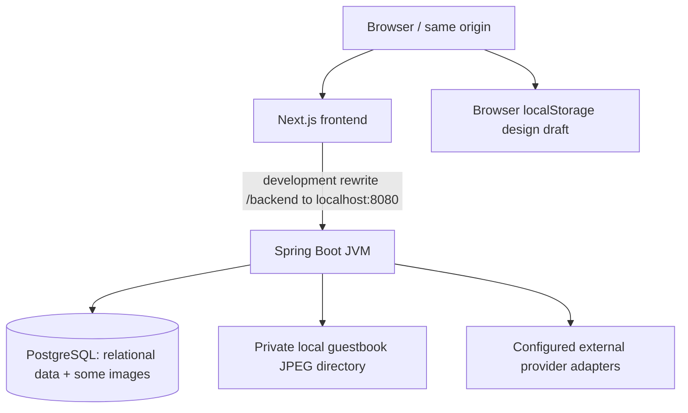
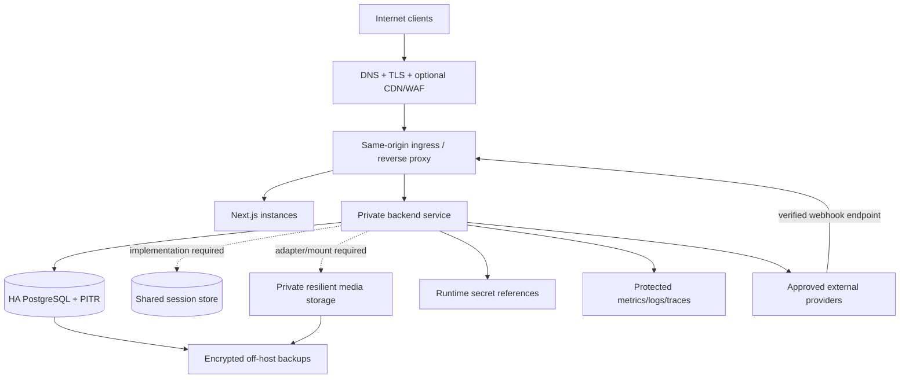

# Document 3 — Production Readiness & Operations Handbook

**Growth and performance update — 6 November 2026:** [Current implementation and rollout](releases/2026-11-06_GROWTH_AND_PERFORMANCE.md) covers the public home/demo, guided creation in both views, mobile invitations, consented sharing previews, bounded dashboard insights, approved-wishes keepsakes, image delivery and admin controls. Current schema head is V107. This update supersedes older route/default descriptions for the changed screens; it does not certify production deployment or live payments.

This handbook distinguishes **Implemented** (source/export evidence), **Unknown** (not established by the repository), and **Proposed default** (an engineering starting point requiring approval and implementation). It is not a certification that the application is production-ready. No infrastructure was deployed, credentials changed, provider account funded, merchant enrolled, customer row read or live payment executed to create this package.

The final section is the required prioritized gap register. It is deliberately the last section of this document.

## 1. Environment setup

### 1.1 Development

Implemented baseline: Java source target 21, Maven wrapper, PostgreSQL-backed Flyway/JPA/JDBC backend, Next.js/React/TypeScript frontend, npm lockfile, Docker-backed integration tests and ImageMagick-dependent guestbook conversion. Current declared/resolved package details are in [DEPENDENCY_CATALOGUE.md](DEPENDENCY_CATALOGUE.md).

Suggested local sequence, from the repository root (substitute the actual checkout directory):

```sh
cd backend
java -version
./mvnw -version
# Provision a dedicated local PostgreSQL DB/user; do not reuse a production DSN.
# Supply environment/secrets through a private local launcher or secret manager.
./mvnw spring-boot:run
```

In another terminal:

```sh
cd web
npm ci
npm run dev
```

The checked-in frontend rewrite assumes a backend on localhost:8080. Confirm the PostgreSQL port/database/user against the safe example configuration; do not copy a developer's private active properties file into staging or production. `gift.payment.profiles.enabled` requires valid encryption/fingerprint key material. OTP signing material and provider keys must be supplied as required by the chosen configuration. Use test/simulator/disabled providers deliberately; never make an unconfigured provider report success.

Guestbook photos require `magick` in PATH with the necessary JPEG/PNG/WebP/HEIC codecs and bounded resource policy. Check conversion with a non-personal fixture. Java image/QR rendering also needs its normal headless fonts/graphics support. The selected fonts must exist or render consistently under export; local browser font fallbacks are not a PDF/print-font guarantee.

### 1.1.1 Invitation Studio uploads and stationery

Implemented: the studio offers separate QR and invitation downloads, a tabbed design library, and undo/redo with one history step per completed drag. The library contains 36 built-in stickers, 48 built-in backgrounds, and ten premium stationery backgrounds. Template previews compose event details, typography, decorative elements, and a protected QR area.

Deploy the frontend and restart the backend so Flyway applies V100–V102. V100 refreshes the six seeded premium designs, V101 creates private host upload storage and access controls, and V102 adds four premium designs. Existing admin-set Free/Premium tiers and publication choices are preserved for refreshed designs.

Admin → Hosts & privileges → select a host → **Custom invitation uploads** controls access. Enable uploads, then choose whether an active premium host plan is required. Turning off the paid requirement explicitly grants complimentary access. Existing host-plan pricing and checkout apply; this change does not enable live payments or alter prices. Both admin approval and the configured entitlement rule are enforced on the upload, list, and image endpoints. Images are private to their owner; revoking access blocks further retrieval through these endpoints.

Admin → Invitation gallery can upload backgrounds or decorations, select Free/Premium during upload, and publish drafts. Premium previews retain GiftWise watermarks; clean platform artwork continues to require the existing commercial entitlement.

### 1.2 Test

Existing build separation: Surefire runs ordinary `*Test` classes and excludes the configured integration naming patterns; Failsafe runs `*IntegrationTest`, `*IT` and `*ITCase` during verify. Some ordinary test classes still use PostgreSQL/Testcontainers, so Docker access is needed for the full test command. Exact include/exclude patterns live in pom.xml.

```sh
cd backend
./mvnw test
./mvnw verify
```

```sh
cd web
npm ci
./node_modules/.bin/tsc --noEmit --incremental false
npm test
npm run build
```

Test data should use generated UUIDs, example contacts and isolated ephemeral databases. Production credentials/recipients must not be part of fixtures. Do not enable a live AI/payment/message provider for an ordinary test suite. Mock provider responses for error/retry/duplicate cases and keep explicit paid/live probes separately controlled.

Current 2026-11-02 evidence: the full backend unit/HTTP suite passes **685 tests, 0 failures/errors/skips**. The schema/API export and dedicated celebration integration tests passed against isolated PostgreSQL V97 databases. The full integration run completed 595 tests with one outdated host-visibility assertion; the corrected test passed an isolated rerun. The 2026-11-02 full frontend suite passes 405 tests; TypeScript and the production frontend build pass. Earlier stale navigation/address expectations were repaired. Browser UAT, provider/live acceptance and production recovery are still not attested. Re-run current CI commands; do not turn historical counts into current deployment approval.

### 1.3 Staging

Unknown: an actual staging domain, cloud account, network, deployment tool, production-like fixtures, provider entitlement and delivery recipients were not supplied.

Proposed default: a separate environment/account or strongly isolated namespace with its own database, buckets/volumes, encryption/HMAC keys, OTP delivery sender, test payment keys, AI project budget and access controls. Use synthetic or explicitly approved anonymized data. Rehearse real proxy/cookie/TLS behavior, account/feature toggles, webhook signature/idempotency, QR scanning, image conversion and restore/rollback. Never share staging signing keys or provider webhook secrets with production.

### 1.4 Production

Unknown: domains, hosting provider, service accounts, certificates, database HA, storage technology, backup destination, change window and on-call ownership. No deployment/IaC definition was identified in the inspected source paths. External infrastructure may exist but is not evidence in this package.

Proposed initial topology: a TLS-terminating reverse proxy/load balancer serving one canonical browser origin; Next.js service; Spring Boot service behind private ingress; managed PostgreSQL or equivalently operated HA PostgreSQL; backed-up private guestbook storage; protected observability and secrets services. Start with an explicitly capacity-tested single writer/backend deployment if sessions/files remain process/local. Do not claim stateless horizontal scaling until session and file behavior is implemented and tested.

## 2. Configuration and secrets

[CONFIGURATION_CATALOGUE.md](CONFIGURATION_CATALOGUE.md) enumerates 61 explicit property keys discovered across application/example files, `@Value`, `Environment.getProperty`, conditional beans and configuration-binding records. It distinguishes injection fallbacks, example files and local values, records explicit/conventional environment names and redacts private values. Database-backed controls are additional configuration and must be deployed/seeded separately.

### 2.1 Critical configuration families

| Family | Required deployment decision | Safe production treatment |
| --- | --- | --- |
| PostgreSQL URL/user/password and migrations | Actual DSN, network/TLS, least-privilege runtime vs migrator roles, pool sizes | Store secret reference; validate schema with Flyway and ORM; never use ddl-auto create/update as a migration substitute. |
| OTP/signing material | `gift.otp.secret-base64` / applicable HMAC key, account scopes, expiry/attempt policies | Strong generated private material, scoped use and rotation plan; do not publish codes or use dummy test key. |
| Receiving-account encryption/fingerprints | Separate base64 encryption and fingerprint keys, version/rotation custody | Use approved secret storage, restore-test decryptability, never discard old decrypting material before migration. |
| Razorpay checkout/webhook | Test-mode implementation boundary, provider keys and signed webhook address | Keep test/live distinct; do not replace `rzp_test` checks casually. Live rollout requires a reviewed implementation and provider approval. |
| Verification providers | Enabled/environment/provider flags and credentials | Sandbox registration is not production verification; keep disabled without entitlement and tested response binding. |
| Email/SMS | Selected supported provider, sender/template/region, actual delivery readiness | Disabled is preferable to fake success; use local simulator only under explicitly allowed local profile/private inbox. |
| Guest URL and routing | Canonical public HTTPS invitation origin and `/backend` proxy target | Same-origin cookies/CSRF; no localhost links or untrusted forwarded-header assumptions in production QR. |
| Guestbook files | Private persistent storage directory and ImageMagick runtime | Correct ownership/mount/backup, no public raw directory access, monitor capacity and conversion failures. |
| AI invitation | Backend key/model, provider project access/credits, platform/host/event grants | Key never goes to browser; enablement is not credit funding; expose safe billing/rate/configuration errors only. |
| Module/verification/payment/commercial DB controls | Intended initial states and approved operator | Prefer explicit reviewed grants. New album/AI event features default off; activate platform + host + event. |
| Actuator | Health/metrics exposure and administrator protection | Restrict sensitive details to internal/admin routes; external health probe should reveal minimal information. |

Additional production values not fully declared in source: session cookie Secure/HttpOnly/SameSite/domain, trusted proxy/forwarded-header configuration, HSTS/CSP policy, request limits at every proxy hop, service/JVM budgets, SMTP/domain reputation configuration, AWS runtime identity, telemetry endpoints, DNS and certificate renewal. These are missing deployment requirements, not implied by Spring defaults.

### 2.2 Secret rotation and verification

Maintain an inventory of secret owner, environment, version, consumers, expiry, rotation procedure and emergency revocation. Proposed default: use a secrets manager and runtime identity; never bake production secrets into Git, container layers, exported documentation or client bundles. Rotate API/webhook secrets with overlap only where the provider and application support it. Rotate data-encryption material only through a tested re-encryption/versioning process with verified backup restoration. Changing a key without data migration can make receiving accounts unreadable.

The documentation export reads no customer rows and does not write active secret values. Its scanner redacts sensitive configuration and token-like literals. A generated documentation bundle still contains architecture and source references and belongs in an access-controlled engineering repository.

## 3. Infrastructure design

### 3.1 Current source-supported topology



Operational implications: a backend restart can lose process-local HTTP sessions; moving a browser to another instance can invalidate group/individual ownership context without a shared session strategy; moving to a node without the guestbook volume can produce missing photos; DB image binaries increase database/backup growth; a browser-local draft is not an off-device backup.

### 3.2 Proposed production topology, not implemented infrastructure



| Component | Implemented evidence | Proposed operating choice / unknown |
| --- | --- | --- |
| Frontend hosting | Next App Router code and npm scripts | Node service compatible with resolved Next version; runtime version must be pinned/tested in CI. Hosting domain/provider unknown. |
| Backend hosting | JVM Spring Boot process | Immutable artifact/container, private network access and health probes. Container/systemd/Kubernetes manifests are not supplied. |
| Database | PostgreSQL with Flyway and explicit locking | HA/PITR-capable service, separate runtime/migration principals, encrypted backup and restore exercises. Size/region unknown. |
| Cache | No external cache implementation attested | Avoid caching private/financial/auth responses. Add only with owner/scope/version invalidation design. |
| Sessions | HTTP sessions / creator/member/individual attributes | Shared, compatible session persistence or deliberately constrained single instance/stickiness with documented failover loss. Stickiness alone is not resilience. |
| CDN | Not implemented/verified | Public immutable free assets only by reviewed policy; never cache private wish photos, account details, reports or token responses by a shared cache key. |
| Queue | DB outbox/notification intent exists | Choose a real delivery worker, retries, dead-letter handling and provider receipts before promising notification delivery. No queue service is configured by the repository. |
| Object storage | Guestbook files are local; other assets can be DB binaries | Private shared filesystem/object-store adapter, scoped delivery, lifecycle and consistent backup. Do not simply point a filesystem Path at an S3 URI. |
| Load balancer | Local frontend rewrite only | Preserve canonical origin, cookies, request body limits, timeouts and trusted client IP semantics; test signed webhooks byte-for-byte. |

## 4. Deployment, migration and rollback procedure

### 4.1 Release preparation

1. Record exact source revision plus any approved working-tree patch; generate SBOM/dependency report, artifact hashes and configuration revision. A dirty development tree is not a deployable immutable release ID.
2. Run unit/integration tests, TypeScript, frontend tests/build, schema export/diff and security scans. Record known failures with an approved disposition; do not hide them behind a focused green subset.
3. Review every new Flyway migration for locks, backfill size, checks/uniqueness, constraints on existing data and backward compatibility. Rehearse against a production-sized approved staging copy.
4. Verify provider modes, feature defaults, AI credits, receiving-account encryption, approved recipients and public QR domain. Readiness switches must not be confused with actual provider capability.
5. Take/rehearse a consistent pre-release restore point for DB and filesystem media. Verify decryption material and application version are recoverable with it.

### 4.2 Deployment sequence

Proposed default: temporarily suppress new risky payment/publish actions if the migration requires it; drain active requests; run migrations through one controlled migrator; verify Flyway success and schema validation; deploy the compatible backend; deploy frontend/proxy configuration; run protected smoke tests with synthetic owned resources; verify guest public routes and real QR resolution; gradually enable intended modules/hosts/events. Do not run parallel uncontrolled DDL migration jobs across replicas.

Backward-compatible schema evolution should precede code that needs new columns; dropping/renaming required fields requires an expand/migrate/contract plan. The current repository does not supply zero-downtime rollout automation or feature-release orchestration; implement it before claiming that deployment pattern.

### 4.3 Rollback

For application-only faults, roll back to a previously tested artifact compatible with the current schema and configuration. Do not edit Flyway history/checksums or remove financial rows to make old code run. For incompatible schema/data faults, choose a reviewed forward repair or restore plan; freeze relevant writes first and preserve provider webhook/event evidence arriving during the incident. Restore can lose post-backup records, so reconcile all provider/manual/payment/outbox events before reopening financial operations.

A safe rollback has evidence: artifact available, compatible DB snapshot/schema, secrets recoverable, media consistent, public DNS/proxy correct, active sessions handled, provider keys/webhooks aligned and post-restore reconciliation complete. None of these is established by a code revert alone.

## 5. Storage planning and retention

### 5.1 Inventory and growth drivers

- Relational identity, event, gift, membership, payment, OTP, verification, grants, audit and commercial data live in PostgreSQL.
- Gallery assets, gift photos, QR/design image columns and provider QR assets can be bytea/binary data in the DB; inspect [Database catalogue](DATABASE_CATALOGUE.md) rather than assuming all media are filesystem objects.
- Guestbook photos are normalized private JPEGs in the configured directory. They require an independent durable backup coupled with DB references.
- Invitation editor localStorage drafts are browser-specific and are not covered by server backups. Exporting a draft is an explicit user action.
- Immutable activity/audit/history/outbox and webhook tables can grow independently of active event count. Indexes and WAL/replication/backup copies add space beyond raw row bytes.

Observed guestbook bounds include a 5 MB upload check, normalization to at most 1600×1600 and an optimized JPEG size guard of 3 MB; request/proxy limits and other media pipelines have their own source limits. Gift photos have their own minimum dimensions and processing. These are bounds, not measured average file sizes.

### 5.2 Capacity model — illustrative only

No real traffic, current row count, average row/image size or retention volume was provided. Do not advertise a concurrency or TB forecast as measured. Use:

```text
photo_bytes = events_per_period × participating_guests_per_event × photos_per_guest × measured_average_normalized_bytes
relational_bytes = sum(per_table_new_rows × measured_table_plus_index_bytes_per_row)
working_capacity = live_DB + indexes + WAL_headroom + media + temp_conversion_space
protected_capacity = working_capacity + backup_copies + replicas + growth_buffer
```

Illustrative scenario, not an application requirement: 1,000 events × 100 photo-contributing guests × 1 photo × 1 MB average = roughly 100 GB of new image content, before copies/indexes/backups. An actual compressed JPEG average can be very different. Load a representative approved fixture, measure it, and plan from those measurements. Proposed initial alert threshold is 70% disk utilization warning / 85% critical with a growth-days forecast; review the thresholds for the chosen platform.

Read-only measurement examples for an authorized operational database:

```sql
SELECT pg_size_pretty(pg_database_size(current_database()));
SELECT relname, pg_size_pretty(pg_total_relation_size(relid))
FROM pg_catalog.pg_statio_user_tables
ORDER BY pg_total_relation_size(relid) DESC;
```

Measure media directory bytes and conversion temporary space separately. No automatic archive tier or storage lifecycle job was verified. Archive/export must preserve financial/audit associations and private-media ACLs; removing a referenced file is data loss, not an archive.

### 5.3 Proposed retention tiers, pending approval

| Data class | Implemented lifecycle | Proposed decision/default |
| --- | --- | --- |
| OTP/recovery secrets | Expiry/consumption and attempt checks | Define a short purge window for expired secret-bearing rows; a proposed 24-hour post-expiry purge needs implementation and security approval. Keep only approved non-secret operational evidence. |
| Authentication/security telemetry | Scoped rate/attempt/version metadata | Proposed 30–90 day searchable operational window; actual privacy/security/legal need must set final retention. |
| Guest contact/messages/photos | Ownership/moderation/access state; no comprehensive erasure policy attested | Retain only under an approved event/consent policy; implement deletion/export/revocation and backup treatment before promising a duration. |
| Financial/provider/audit records | Constraints, idempotency and some immutable history | Do not auto-purge without finance/legal-approved retention and reconciliation design. No country-specific retention period is invented here. |
| Commercial/affiliate statements | Revision/history and statement state | Approved accounting retention and partner evidence handling; clicks and paid statements are distinct. |
| Browser drafts | localStorage/export | User/browser lifetime only; clearly document lack of server synchronization/recovery. |
| Backups | No schedule/restore attestation supplied | Proposed daily/weekly/monthly tiers below; encryption, access, deletion and restore policy must be approved together. |

## 6. Performance, reliability and scaling

No measured sustainable user concurrency, requests/second, percentile latency, failover duration or workload mix was supplied. Existing metrics histogram/SLO buckets are instrumentation configuration, not a production performance promise.

Proposed acceptance workload should include public event reads, RSVP bursts, group guest contributions, authenticated reports, QR/artwork rendering, guestbook image conversion, metadata requests, AI provider wait, webhook retry storms and admin capability updates. Separate CPU-heavy rendering/conversion, external I/O and DB transaction latency. Measure p50/p95/p99, throughput, error rate, CPU/memory/GC, connection utilization, query latency/locks, WAL/media growth and provider limits.

### 6.1 Proposed initial targets for validation, not existing guarantees

| Signal | Proposed starting objective | How to validate |
| --- | --- | --- |
| Ordinary reads | p95 under 500 ms at the agreed initial workload | Load-test warm/cold paths and scoped DB plans; exclude AI/image jobs from this generic target. |
| Ordinary validated writes | p95 under 1 s excluding external provider wait | Include locks/uniqueness/idempotency and parallel same-event writes. |
| Availability | Start with a product-approved monthly SLO, e.g. 99.9%, only after failure-budget review | External dependencies, planned downtime and data correctness must be explicitly scoped. |
| QR/artwork and photo conversion | No QR decode regression; bounded CPU/memory/time; latency target measured | Test actual deployed codecs/fonts and concurrent uploads/rendering. |
| AI/provider calls | Follow implemented client timeouts; display clear timeout/unavailability | Test provider 4xx/5xx, quota exhaustion, slow response, refusal and invalid output. Never auto-loop on insufficient credits. |
| Webhook correctness | Zero duplicate financial postings under replay/out-of-order/retry fixtures | Assert provider signatures, binding, idempotency and accounting invariants. |

### 6.2 Scaling prerequisites

1. Externalize or deliberately persist all host/group/individual sessions before assuming any backend instance can serve the same browser. Many in-memory attempt windows also need a distributed limit design for multi-node equivalence.
2. Make guestbook files accessible/durable across serving nodes, and retain API ownership checks. DB binary assets need DB capacity/backup planning even after a media-store change.
3. Size database pools across total replicas, not per replica in isolation. Observe contention on same-event/payment/advisory locks; do not remove correctness locks to improve a synthetic benchmark.
4. Use correct indexes and query plans for report filters, event account links, guestbook pagination and group progress. Read replicas require a deliberate consistency plan for authentication/verification/payment reads.
5. Move expensive conversion/rendering/provider wait into an explicitly designed bounded processing model if load tests require it. No asynchronous job queue is already implied by an outbox row.
6. Scale the frontend separately only after proxy/session/public asset behavior is tested. Shared-cache policy must not cross host/event/private token scopes.

## 7. Monitoring, alerts and runbooks

### 7.1 Required observability

| Area | What to observe | Existing signal / missing work |
| --- | --- | --- |
| Application/API | HTTP status/latency, readiness, thread/heap/GC, restart and exception categories | Actuator/HTTP histograms are configured; production scraper/dashboards/on-call integration unknown. |
| DB | Pool use, connection failures, lock waits, slow queries, storage, WAL/replica lag, backup success | PostgreSQL supports inspection; no production monitoring configuration supplied. |
| Payments | Order age/state, confirmation/webhook rejects, replay conflicts, unresolved manual reports, amount mismatch, outbox backlog | State tables exist; alerting and finance reconciliation ownership need setup. |
| Verification/auth | Issuance failures, expired/replayed proofs, abuse/rate limits, session invalidations, delivery uncertainty | Source guards/attempt records exist; thresholds/runbooks not operationally attested. |
| Storage/images | Missing photo reference/file, failed conversion, disk/temp headroom, processing duration | Current storage is mixed DB/filesystem; unified inventory/backup monitoring absent. |
| AI | Billing/rate/access/connection/invalid-response categories, request quota and failure ratio | Safe categories and request history exist; project credit monitoring is external. |
| Security/admin | Unauthorized/cross-scope calls, CSRF failures, unusual module/payment/policy changes, repeated recovery attempts | Application/admin audit exists; SIEM/access review and incident workflow unknown. |
| Notifications | Pending age, retries, provider accepted/delivered/failure counts where real transport exists | Not every outbox has a dispatcher or provider delivery receipts. Never alert on a fake “sent” transition. |

Proposed initial alerts: CPU >70% for 10 minutes / >90% for 5 minutes; memory or heap pressure >80% sustained; disk >70% warning / >85% critical; 5xx >1% for 5 minutes with minimum request volume; DB pool exhaustion/long lock waits immediately; no successful backup within the approved schedule; webhook signature/amount mismatch spikes; payment confirmation pending beyond approved provider windows; delivery/auth failures beyond measured baseline. These are proposals, not configured alerts or safe universal thresholds. Attach owners, runbook links, severity, suppression, escalation and recovery checks.

### 7.2 AI unavailable / credit exhausted

Inspect the safe response code and request status, not raw secrets/provider bodies. AI_CREDITS_EXHAUSTED means the configured project requires funding/account action; a host/event grant cannot solve it. AI_PROVIDER_CONFIGURATION requires key/project/model access review. AI_PROVIDER_RATE_LIMITED needs a bounded wait and quota review. AI_PROVIDER_CONNECTION/UNAVAILABLE requires provider/network observation. AI_INVALID_RESPONSE requires contract/output validation investigation. Existing invitation remains unchanged; do not claim a local template was generated by AI. After restoring access, retry deliberately within the application request limit.

### 7.3 Payment uncertain / duplicate / webhook failed

Find the existing local order/claim/payment and original idempotency/reference. Compare provider facts and signature/config revision; preserve the original evidence and any asynchronous webhook. Do not create a new payment to “retry” a confirmation, bypass an amount mismatch, directly credit a ledger, or manually relabel an unverified claim as settled. Use the appropriate verified reconciliation path or a reviewed finance incident process. Live refund/payout dispatch is not a provided fallback.

### 7.4 Guestbook photo missing or conversion failure

Check the DB record's private filename reference, the configured media mount and service UID, file existence, available disk/temp space, ImageMagick binary/codecs/policy and processing bounds. Do not serve a raw upload or remove filename/path checks to make the photo display. Restore the correctly scoped normalized file from the consistent backup or show the existing text/fallback while recovering it. Private album photos require their own effective host/event grant.

### 7.5 CSRF/session/authorization mismatch

Verify canonical origin, session cookie, XSRF cookie/header pair and applicable `X-Group-Page-Id`; check current actor/credential epoch, idle timeout, group/event scope and module grants. Do not globally disable CSRF or owner checks. Null/missing optional `independentGift` defaults false; malformed payloads must not prevent a validly formed unauthenticated setup request from reaching the normal login boundary. Group member logout must remain possible after readiness loss and clear only the matching group scope.

### 7.6 Database lock/migration failure

Stop repeated mutating retries; capture migration version/checksum, lock wait/query and affected invariant using redacted evidence. Confirm whether a deploy or concurrent transaction owns the lock. Use a reviewed forward repair/restore process. Never delete Flyway history, disable a critical uniqueness/check trigger or reduce a payment lock solely to make a test/deployment pass.

## 8. Backup, disaster recovery and business continuity

**Unknown:** actual backup process, offsite copies, encryption, retention, restore test, failover, RTO/RPO and responsible people. The following is a proposed plan requiring implementation and rehearsal.

### 8.1 Proposed schedule and objectives

- Database: continuous WAL/PITR plus daily validated base backup; keep 7 daily, 4 weekly and 12 monthly recovery points as an initial proposal, subject to storage/legal/privacy approval.
- Private media: incremental/daily backup with versioning/snapshots; consistent DB reference/media manifests and protected off-host copies. A media deletion policy must account for backup lifecycle.
- Configuration/artifacts: immutable release hash, schema version, non-secret config revision, secret version references, ImageMagick/fonts/runtime and proxy configuration.
- Target RPO: proposed 15 minutes for DB with working PITR; media RPO must be explicitly aligned rather than silently accepting a daily-only gap. Target RTO: proposed 1 hour only after a representative restore drill proves it.
- Quarterly full recovery drills and per-release rollback rehearsal are proposed, not executed evidence.

### 8.2 Recovery procedure

1. Declare incident owner, stop risky writes and document the last trusted state/time; preserve provider webhook/order evidence and logs without secrets.
2. Choose the approved recovery point and restore PostgreSQL into an isolated recovery target. Verify checksums, schema/history, constraints and accounting invariants.
3. Restore matching private media and artifact/config/secret versions. Confirm that encrypted receiving-account data can still be decrypted only within correct scope.
4. Reconcile provider events and any accepted writes after the recovery point. Do not double-credit replayed webhooks or resend uncertain notifications blindly.
5. Run authentication/owner/module checks, guest link/QR scan, report totals, album private photo, verification, quote/claim/webhook and audit smoke tests.
6. Move traffic only after business/finance/security acceptance, monitor closely, then close with a documented data-loss/repair account and corrective actions.

Failover must specify session loss, media consistency, DNS/ingress changes, primary promotion/fencing, webhook destination continuity and idempotent replay. No automatic failover implementation is proven by the source. Business continuity during provider failure may offer an explicitly permitted manual reporting path, but must not misrepresent verified payment, refund or payout capability.

## 9. Security hardening checklist

- [ ] Pin reviewed runtime/dependency versions; generate an SBOM and triage vulnerable direct/transitive packages.
- [ ] Provision HTTPS and automated certificate renewal; enforce secure cookies and approved SameSite/domain/path behavior through the actual proxy.
- [ ] Define trusted proxy/forwarded-header handling and effective client IP; do not trust arbitrary X-Forwarded-For for abuse controls.
- [ ] Keep DB and private backend ports private; use least-privilege runtime, migration, backup and monitoring principals.
- [ ] Supply secrets through a vault/runtime identity; verify no client bundle/log/docs contain API keys, OTPs, passwords or decrypted account values.
- [ ] Verify key lengths, separation, rotation and restore decryptability for encryption/HMAC/webhook credentials.
- [ ] Retain CSRF, role, ownership, event/module and scoped creator/member/individual checks. Exercise cross-host and direct-API bypass attempts.
- [ ] Define distributed edge/application rate limits, upload body/time limits and provider budget protections; configure WAF/DDoS protection if selected.
- [ ] Protect actuator/metrics and administrative detail/report surfaces; restrict raw exception/provider detail exposure.
- [ ] Verify SSRF defenses through redirects/DNS/private addresses; do not allow arbitrary internal URL fetches.
- [ ] Verify upload format/signature/decompression/resource limits and codecs; prevent raw media directory traversal/public listing.
- [ ] Define CSP/security headers compatible with the approved payment script, same-origin media and design exports; test instead of copying an unreviewed blanket policy.
- [ ] Approve cookie/contact/media consent, privacy/erasure and financial retention policies; implement them.
- [ ] Add security scanning, dependency alerts, static checks and an independent penetration-test plan with ownership/remediation evidence.
- [ ] Make audit access/review, incident reporting, evidence retention and privileged change approval operational.
- [ ] Review the absence of PostgreSQL RLS policies and rely on tested app scoping unless a deliberate DB isolation design is added.

## 10. Production go-live checklist

### Infrastructure, data and release

- [ ] Approved environment topology, regions, domains/DNS/TLS, canonical QR URL and `/backend` reverse-proxy configuration.
- [ ] Immutable backend/frontend artifacts, reproducible build, release/source/config/schema IDs and SBOM recorded.
- [ ] Source V1–V97 and future migrations rehearsed on an approved representative database; schema checks/permissions/locks reviewed.
- [ ] Shared-session/media strategy implemented or explicitly constrained; load-balancer behavior/failover tested.
- [ ] Resource, pool, disk/WAL/temp/media capacities and scaling limits measured against an approved workload.
- [ ] Encrypted DB and filesystem-media backups scheduled, monitored, off-host and actually restored; approved RTO/RPO proved.
- [ ] Application/schema rollback and provider-event reconciliation rehearsed with a named release/incident owner.

### Security, identity and feature access

- [ ] Session/cookie/CSRF/owner/admin/group/individual boundaries verified end-to-end through production-like HTTPS.
- [ ] Registration/recovery/verification delivery works with approved real recipients; simulators/local profiles disabled in production.
- [ ] Secrets provisioned, scanned, rotated/recovery tested; no plaintext private configuration distributed.
- [ ] Every module and payment/verification/commercial gate has an intended initial state; album/AI platform/host/event grants are deliberate.
- [ ] Security scans and independent testing completed; critical findings remediated or release blocked.
- [ ] Privacy/consent/retention/deletion/export and support-access rules approved and implemented.

### Payments and communications

- [ ] Merchant/provider entitlement, test/live environment, public keys, secret keys and webhook signing configuration verified externally.
- [ ] Quotes, accepted totals, currency/amount/order/payment binding, signature and idempotent duplicate/out-of-order handling verified.
- [ ] No manual report/acknowledgement/count is shown as independently received/settled funds.
- [ ] Receiving accounts are correct, event-linked/selected, enabled and actually eligible; verification claims match environment/evidence.
- [ ] Payouts/refunds are explicitly unavailable or a separately completed, reviewed implementation is accepted; no placeholder is advertised as live.
- [ ] Email/SMS sender/template/region policies, actual transport behavior and uncertain-delivery handling are tested.
- [ ] Outbox delivery worker/receipts are implemented wherever the product promises notifications; pending intents remain labelled correctly.
- [ ] AI project access/model/credits/budget monitoring work; safe credit/rate/configuration errors and unchanged-draft behavior verified.

### UX, performance and acceptance

- [ ] All 28 routes and conditional dialogs/forms have role/empty/loading/error/retry/mobile/browser acceptance coverage.
- [ ] Full backend/frontend/integration/type/build suites are green or have explicitly approved, non-blocking dispositions.
- [ ] Real exported invitation QR decodes to the intended published event on multiple supported devices/print conditions.
- [ ] Individual/group guest privacy, optional registration, contact policies, targets/publication/fulfilment and account setup journeys pass UAT.
- [ ] Memory album loading/paging/private photos/hidden wishes/playback/fullscreen and admin enablement pass UAT.
- [ ] Commercial placement/premium access/affiliate disclosure and separated revenue state have product/finance acceptance.
- [ ] Load, soak, burst, media conversion, provider failure, webhook replay and DB contention tests meet approved targets.
- [ ] Monitoring/alert routes, thresholds, dashboards, escalation, support playbooks and incident exercises are verified.

## 10.1 Implemented safeguards update — 2026-11-02

The [controlled rollout](releases/2026-11-02_CELEBRATIONS_AND_SAFEGUARDS.md) records additive celebration features, permission controls, API/field contracts, V96 and rollback restrictions. The [operations toolkit](../../ops/README.md) provides production profile requirements, coordinated DB/media backup, guarded disposable restore and automated release checks.

**Implemented:** separate environment-only executable production build profile and artifact-configuration check; minimal service health probes with protected metrics; opt-in `production`/`prod` startup policy and admin configuration status; secure/HttpOnly/SameSite cookie settings; schema validation/Flyway-clean restrictions; placeholder-key/simulator/profile checks; explicit single-instance limit; explicit private media path; bounded Razorpay transport (connect 5 s/read 20 s, redirects disabled); backup integrity/unsafe-archive checks; restore-to-empty `_restore` targets only; frontend regression expectation repair for earlier navigation/address changes.

**Not established:** real infrastructure, TLS/DNS/ingress/client-IP behavior, provider entitlements/credits/merchant routing, live payout/refund capability, off-site encrypted backups/WAL/PITR, timed recovery, actual notification delivery, distributed sessions/rate limiting, legal/retention policy, full browser/accessibility/load/pentest evidence. A configuration check is not a substitute for these release gates.

New feature rollout requires platform AND host AND event approval. New modules start off; existing gifting defaults remain unchanged. Invitation-only status persists when access is revoked so that revocation does not unexpectedly reopen collections. Published events must become private before settings edits; existing gifting activity prevents conversion to invitation-only mode. See the release note for the older-binary rollback restriction.

## 10.2 Localisation implementation update

[Platform localisation](releases/2026-11-02_LOCALIZATION.md) adds global availability, inheritable host/event restrictions, account preferences, independent remembered guest choices, dynamic native language metadata and draft/published translation management. English, தமிழ், हिन्दी, മലയാളം, ಕನ್ನಡ, తెలుగు, Español and العربية are registered; multilingual mode defaults off. Missing strings fall back through platform/default/additional/source rules. Customer-authored content, currencies, payment references, ownership and verification evidence remain unchanged.

The framework covers host/guest/admin interface text and code-owned communication templates. Starter packs are partial and require native review; approved provider templates, real delivery and RTL/device acceptance remain external release gates. Dedicated localisation integration tests and the full frontend test/type/build checks pass at this stage. Existing production payment, deployment, notification dispatch and recovery gaps remain open.

## 11. Final production gap register — required work and missing information

This register is intentionally last. “Proposed default” is a recommendation for review, not an implemented fact or an assumption that missing infrastructure already exists. Owners are role proposals because named accountable people were not supplied. Block production promises that rely on an unresolved blocker.

| ID | Priority | Gap / missing evidence | Proposed default or required action | Proposed owner / acceptance evidence |
| --- | --- | --- | --- | --- |
| PROD-01 | Blocker | No attested production/staging infrastructure, domains, DNS, certificates or deployment manifests | Approve isolated environments; canonical HTTPS origin; private backend/DB; versioned IaC/release definitions | DevOps/architect; reviewed manifests and smoke-tested endpoints |
| PROD-02 | Blocker | Current payment paths enforce test-mode expectations; live merchant enrollment/routing/compliance not completed | Keep test paths labelled/isolated; implement and independently approve a live payment launch before collecting real provider payments | Payments/finance/security; provider approval and signed E2E/reconciliation evidence |
| PROD-03 | Blocker for withdrawal promises | Live payouts are false; UI requests are blocked; no production dispatch/finalization workflow | Do not market live withdrawals. Define onboarding, approval, idempotent dispatch, provider webhooks, accounting and reconciliation | Payments/finance; completed audited payout lifecycle |
| PROD-04 | Blocker for refund promises | No refund endpoint/workflow discovered | Define refund eligibility, approvals, provider API, idempotency, accounting reversal and failure/reconciliation process | Product/finance/payments; tests and operational sign-off |
| PROD-05 | Blocker | Backup/integrity/disposable-restore scripts now exist; no verified production restore/failover or approved RTO/RPO | Implement DB PITR and coordinated private-media backups; proposed RPO 15 min/RTO 1 h only after drill proves them | DevOps/DBA; timed recovery drill and reconciliation report |
| PROD-06 | Blocker | Startup rejects placeholder/missing keys and production artifact excludes private local configuration; secret custody/rotation/recovery still not attested | Secret manager/runtime identity, separated encryption/HMAC keys and tested versioned data-key recovery/rotation | Security/DevOps; secret inventory and decrypting restore evidence |
| PROD-07 | Blocker for multi-instance deployment | Production startup explicitly limits declared deployment to one instance; shared sessions/distributed abuse limits remain absent | Implement/test shared sessions and distributed abuse limits, or explicitly constrain initial deployment/failover behavior | Backend/DevOps; cross-node host/creator/member/individual tests |
| PROD-08 | Blocker for resilient media | Guestbook photos use local filesystem while other images use DB binaries | Durable shared private storage or reviewed adapter; consistent DB/media backups; missing-file monitoring | Backend/DevOps; node loss and restore tests |
| PROD-09 | High | No actual workload, measured capacity, latency/error SLO or concurrency benchmark | Approve traffic mix; measure load/soak/burst/lock/render/provider behavior; publish limits and alerts | Product/performance/DevOps; benchmark and SLO review |
| PROD-10 | High | No deployed dashboards, alert routing, on-call and incident escalation evidence | Configure protected observability and proposed initial thresholds, then tune to baseline | SRE/support; exercised alerts and runbooks |
| PROD-11 | High | Notification intents exist without universal dispatcher/delivery receipts | Implement actual transport, bounded retry/dead-letter/idempotency and provider receipt state where delivery is promised | Backend/communications; provider-confirmed tests |
| PROD-12 | High | Email/SMS regional entitlement/sender/template/deliverability not verified | Configure supported providers; approved sender/recipient tests; no simulator in production | Communications/security; delivery and uncertain-outcome evidence |
| PROD-13 | High | Verification provider production entitlement/schema/name matching not attested; sandbox scaffolding remains | Keep sandbox claims distinct; complete approved request binding, response matching, account-name rules and audit/reconciliation | Payments/security; production-verification acceptance |
| PROD-14 | High for AI use | AI project credits/access/configuration are external; prior probe reported exhausted credits | Fund/authorize the configured project, monitor budgets/credits and test safe failures; grants do not supply credits | Admin/AI owner; successful controlled paid probe and budget alert |
| PROD-15 | High | Production secure/HttpOnly/SameSite cookies and error restrictions implemented; actual TLS/proxy/CORS/WAF/client-IP policy still not verified | Explicit reviewed same-origin HTTPS/cookie/proxy policies; test CSRF and signatures through ingress | Security/DevOps; production-like security tests |
| PROD-16 | High | No independent security audit/pentest/compliance approval | Risk assessment, threat model, dependency scans, penetration test and tracked remediation | Security/product; signed report and critical findings closed |
| PROD-17 | High | No approved PII/photo/contact/financial/audit retention, consent, export, erasure or backup-deletion policy | Define policies before automating deletion; short secret-bearing challenge retention proposed; finance/legal set accounting durations | Product/privacy/legal/finance; policy plus working lifecycle jobs |
| PROD-18 | High | No verified browser E2E/accessibility/mobile/print matrix for all routes and conditional forms | Define supported devices/languages; browser automation/UAT including actual QR scans and large/failed images | QA/design; route/control acceptance matrix |
| PROD-19 | Automated checks resolved; acceptance pending | Full frontend suite passes 405 tests; TypeScript and production build pass. Backend unit/HTTP suite passes 685 tests. Browser/device acceptance remains PROD-18 | Preserve release-bound automated reports and run browser UAT; repeat checks after code changes | Frontend/backend/QA; test/type/build reports and browser acceptance |
| PROD-20 | High | Business requirements and branch rationale are not completely encoded in source | Review all guard/constraint inventories with domain owners; assign requirement IDs and edge-case acceptance tests | Product/architect/QA; signed traceability map |
| PROD-21 | High documentation contract | Static JSX captures declarations/dynamic collections, not every runtime-generated instance; per-control DB/API semantic mapping is not universally explicit | Adopt stable field/action identifiers and typed API/form mappings; review route/control inventory against browser E2E and request logs | Frontend/backend/QA; zero unresolved semantic mapping audit |
| PROD-22 | High API contract | Dynamic Map responses, heterogeneous error envelopes and delegated guard behavior lack a complete formal per-operation schema | Produce reviewed OpenAPI/JSON schemas and contract tests, including each conditional profile and binary/export variant | Backend/QA; schema/implementation diff and contract suite |
| PROD-23 | Medium; partially implemented | Environment-only production artifact/profile and config checks added; deployed configuration precedence and secret inventory remain unverified | Version non-secret production config; validate required properties/flags at startup; keep private local values out of artifacts | DevOps/backend; environment diff and smoke assertions |
| PROD-24 | Medium | Razorpay transport now bounded (5 s connect/20 s read, no redirects); full provider SLA/cost/retry/entitlement matrix remains incomplete | Review each adapter against current approved provider contract; define budget, timeout and uncertain-result ownership | Integrations/product; provider contract checklist |
| PROD-25 | Medium | Browser localStorage invitation drafts have no server backup/synchronization or cross-device recovery | Either document the limitation prominently or implement owner-scoped synchronization/version/recovery | Product/frontend/backend; recovery acceptance tests |
| PROD-26 | Medium | Individual gift management is tied to the browser session | Define a secure cross-device recovery/claim-transfer policy if needed; never recover by public gift UUID alone | Product/security; scoped recovery threat model and tests |
| PROD-27 | Medium | No complete data/key/archive lifecycle automation or schema rollback/compatibility gate | Add reviewed jobs and expand/migrate/contract release rules; preserve immutable history/idempotency | DBA/backend; migration/retention/replay tests |
| PROD-28 | Medium | Maven transitive resolution/SBOM and license/vulnerability review are not fully exported from an immutable release | Generate and sign release SBOM/dependency locks/reports; review maintained versions before upgrade | Build/security/legal; artifact-bound scan and license report |
| PROD-29 | Medium | No support/finance/admin separation beyond CUSTOMER/PLATFORM_ADMIN and scoped group roles | Define least-privilege operational roles/approval boundaries if multiple teams operate production | Security/product; approved RBAC matrix and access review |
| PROD-30 | Medium | Complete production business continuity, rollback ownership, fraud/dispute handling and post-restore reconciliation procedures are not supplied | Assign accountable operators and rehearse tabletop + technical incidents with provider evidence | Product/finance/SRE; exercised incident/continuity plans |
| PROD-31 | High for multilingual release | Localisation framework and eight language records exist; starter packs are partial, and complete native/RTL/device/payment-copy/provider-template acceptance is not attested | Review published-message coverage per language with native speakers; test switching with open forms, all payment/error states, RTL, calendars and approved delivered communications | Product/localisation/QA/communications; language-specific signed UAT and delivery evidence |

## Deploying the growth release

Apply V107 through normal Flyway startup after a verified backup; never reset an existing database. Use the [deployment runbook](../production-deployment/Production_Movement_Steps.md) and [growth rollout details](releases/2026-11-06_GROWTH_AND_PERFORMANCE.md#deployment-and-operations). Rich metadata requires runtime `GIFTWISE_PUBLIC_ORIGIN` and `GIFTWISE_BACKEND_ORIGIN` in the web service environment. The updated kit creates `/etc/giftwise/web.env` and backs it up with encrypted configuration.

Keep rich previews and public keepsakes off until staging privacy checks and host-consent workflows pass. Verify thumbnail requests still return unavailable for unpublished events/private gifts. Check a narrow mobile screen, reduced motion, calendar failure feedback, stale admin save conflicts and analytics consent withdrawal. Measure actual mobile loading, interaction latency, layout shift and database queries before claiming a performance improvement. These changes do not remove the live-payment implementation gap.
