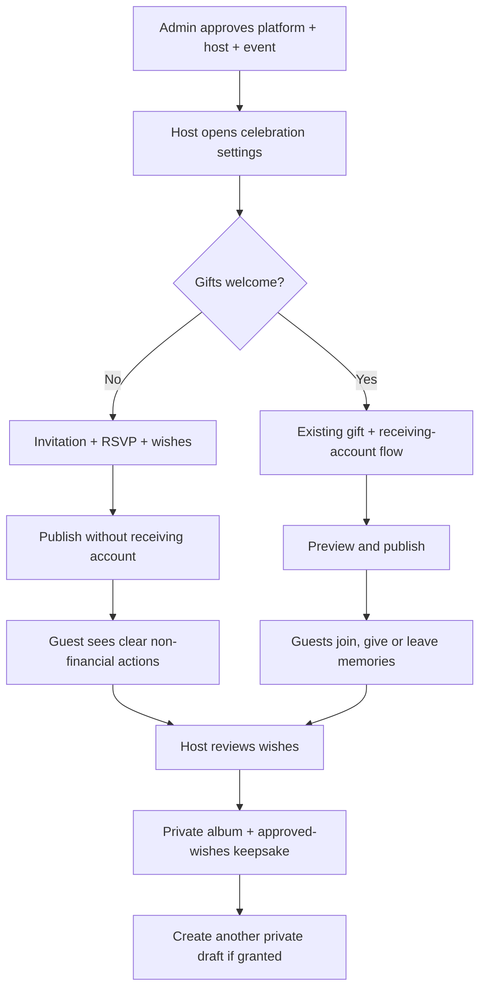

# Family celebrations and office farewells — controlled rollout

Implementation date: 2026-11-02. This release is additive to the documented baseline. It is not a statement that the entire production gap register or five-stage product roadmap is complete. External enrollment, infrastructure, legal decisions and operational evidence cannot be supplied by a source-code change.

## Delivered behavior

| Capability | Behavior | Permission / compatibility |
| --- | --- | --- |
| Family and office occasions | Adds `FAREWELL`, `RETIREMENT`, `REUNION` to existing occasion types; all existing types remain | Additive enum options; existing records unchanged |
| Optional gifting | Owner can select invitation-and-memories only on a draft, add a warm welcome, and publish without a receiving account | `CELEBRATION_PLANNING` must be enabled at platform, host and event; existing events default `gifting_enabled=true` |
| Guest experience | Invitation-only mode hides host wishlist and financial/group entry actions; RSVP/wishes/memories remain subject to their existing permissions | Persisted gifting denial remains effective even after planning permission is revoked |
| Payment boundaries | New checkout orders, hybrid quotes, payment-context/direct-transfer/verified-destination entry and group gifting are unavailable for invitation-only events | Existing confirmation/webhook processing remains available for in-flight accounting; changes require a draft and no gift/group/payment activity. Database insert guards coordinate concurrent activity with policy changes |
| Arrival details | Owner can opt in to showing event venue and arrival/accessibility/parking notes, set start time, region timezone and duration | Requires `CELEBRATION_PLANNING` and `EVENT_ESSENTIALS` at all three levels; default venue sharing is false |
| Calendar | Public guest calendar download uses all-day dates or UTC-converted timed entries; escapes text and folds lines by UTF-8 octets. Rejects daylight-saving gaps/overlaps rather than silently changing the time | Essentials and planning access required; no private contact or separate delivery address included |
| Repeat a celebration | Creates a private draft with a fresh ID/token, basic description/address/contact/delivery details, occasion and gifting mode; date cleared | `EVENT_REUSE` at all three levels on the source; no grants, guests, gift rows, money, account links, photos or AI designs copied |
| Approved-wishes keepsake | Host downloads an offline HTML text card of up to 500 approved wishes; browser Print can produce PDF | Existing platform/host/event memory-album controls; owner-only, no-store, escaped HTML, no scripts/remote assets, no hidden/pending wishes |
| Admin rollout controls | New module switches at platform/host; per-event switches under Recent events; audit records for changes | New modules start disabled; no existing grants overwritten |
| Production startup guard | Explicit production profile rejects insecure cookies, missing HTTPS origin, placeholder keys, simulator/bootstrap modes, unsafe schema settings, missing private media path and declared multi-instance rollout | Applies only to `production`/`prod`; does not prove deployment/provider readiness |
| Operational tooling | Coordinated DB/media backup with checksums/completion marker; restore restricted to empty disposable `_restore` DB; automated release check script | Requires approved operator configuration and stopped writes; encryption/off-site/PITR and real restore evidence remain pending |
| Production artifact | Separate `production-release` Maven build excludes local/example configuration, defaults to production safeguards, and builds an executable environment-configured JAR; artifact check validates configuration | Separate output directory preserves development/test resources; provider/deployment approval still required |
| Service probes | Minimal public health/liveness/readiness; production readiness includes DB and hides details; metrics remain admin-only | Ingress routing and real monitoring/alerting must still be deployed |
| Provider timeout | Razorpay client now uses 5-second connection and 20-second read timeout, no redirects or automatic financial retries | Existing test-mode restriction and idempotency preserved |

## Admin activation

1. Open **Admin → Hosts & privileges**. Enable **Simple celebrations & optional gifting** at platform level, then for the selected host.
2. If needed, enable **Venue details & calendar** and/or **Repeat celebrations** at platform and host level.
3. Open **Admin → Recent events → Celebration feature controls** for the selected event. Enable the corresponding event grants.
4. Host opens **Celebration settings** in that event’s sidebar. A draft can be changed; published events must first be made private using the existing action.
5. Save, preview, publish, and scan the real invitation QR. Turning permissions off removes access without deleting content.
6. Approved-wishes keepsakes use the existing **Memory album** platform/host/event grants. Hosts find the download in the album toolbar.

Platform AND host AND event must all allow a new capability. An event grant alone never overrides a platform/host denial. Venue/calendar editing also depends on planning access. Admins can preconfigure event grants while platform/host access is off; UI explains the unavailable state.

## API contract additions

All responses with private settings and all public details/downloads are no-store. Host endpoints use authenticated owner sessions; mutations require the existing CSRF cookie/header. Admin endpoints require `PLATFORM_ADMIN` and mutation CSRF.

| Method | Path | Request / response |
| --- | --- | --- |
| GET | `/api/v1/events/{id}/celebration-settings` | `Settings` below; planning grant required |
| PUT | `/api/v1/events/{id}/celebration-settings` | Full `Settings`; returns persisted state with incremented version |
| POST | `/api/v1/events/{id}/repeat` | `{ "title": "Our next family gathering" }` → HTTP 201 `{ "id": "uuid" }` |
| GET | `/api/public/events/{token}/celebration-details` | Published invitation only; `PublicDetails` below |
| GET | `/api/public/events/{token}/calendar` | `text/calendar`, attachment `celebration.ics`; 409 if no event date |
| GET | `/api/v1/events/{id}/album/keepsake` | `text/html;charset=UTF-8`, attachment; approved text wishes only |
| GET | `/api/admin/console/events/{eventId}/modules` | List of module code, configured event switch, platform/host availability and effective switch |
| POST | `/api/admin/console/events/{eventId}/modules/{code}` | `{ "enabled": true }`; supports the three new codes only; change audited |
| GET | `/api/admin/console/production-status` | Configuration issues and explicit unverified external readiness; no secret values |

`Settings` fields:

| Field | Type / constraints | Default / mapping |
| --- | --- | --- |
| `giftingEnabled` | Required boolean | True; `events.gifting_enabled` |
| `welcomeMessage` | Required string, max 500, may be empty; stripped on save | Empty; `event_celebration_settings.welcome_message` |
| `shareVenue` | Required boolean; disclosure to everyone possessing public invitation link | False; `share_venue` |
| `startTime` | Optional ISO local time | Null; `start_time` |
| `timezone` | Required valid Java ZoneId, max 80; suggest IANA region | `Asia/Kolkata`; `timezone` |
| `durationMinutes` | Integer 15–1440 | 120; `duration_minutes` |
| `arrivalNotes` | Required string, max 1000, may be empty; stripped on save | Empty; `arrival_notes`; publicly shown only when venue sharing and effective grants allow |
| `version` | Integer >= 0; optimistic concurrency token | 0 initially; increments per successful save under event row lock |

`PublicDetails`: `giftingEnabled`, `welcomeMessage`, nullable `venue`, `arrivalNotes`, nullable `date`, nullable `startTime`, `timezone`, `durationMinutes`. Public output never includes private contact fields or the separate gift delivery address. Host entering private information into the explicitly public welcome/arrival fields is a deliberate publication action, not automatic inclusion of private profile fields.

Errors: 400 malformed/invalid fields or timezone; 401 unauthenticated host; 403 invalid CSRF/role; 404 inaccessible owner/event/module; 409 published/non-draft edit, stale version, existing gifting activity, date not yet set for calendar, or a stored calendar time requiring host review after a date change. Invalid/ambiguous/nonexistent timezone-local start times are rejected on settings save when the date is known. No automatic retry for draft creation, money operations or settings conflicts. Reload and review on uncertain outcomes.

## Data and rollback

Flyway V96 adds `platform_event_module_grants` (composite event/module key, FK to event/control, restricted new module codes), `event_celebration_settings` (one row per event, version/constraints), and non-null `events.gifting_enabled DEFAULT TRUE`. Event-scoped new grants cascade on event deletion. Existing content/grants/financial records are not migrated or deleted.

Four insert triggers guard `payment_orders`, `guest_direct_transfer_claims`, `gift_groups` and `guest_gifts`. They take a transaction-scoped **shared** two-integer advisory lock `(1195984468, hashtext(event_id::text))` and reject inserts when gifting is off (`23514`, constraint identifier `event_gifting_open`). Settings changes acquire the **exclusive** partner lock before the event row lock and activity checks. Thus concurrent contributions share the lock, while a mode change waits for prior contributions to commit and then refuses to hide their activity. Future code that changes gifting policy must use the same lock protocol. This namespace is separate from existing bigint idempotency locks. It is an application/DB protocol, not authorization for operators to bypass policies through direct SQL.

A repeat operation is a new event, not an idempotent update. After an uncertain network result, check the event list before retrying. No automatic financial, provider or notification action is triggered by repetition or saving settings.

Back up and test V96 in staging before deployment. Roll out the new backend and frontend together with new grants off, then pilot selected hosts/events. Keep new schema on application rollback; do not drop tables/columns containing customer settings. Older binaries cannot deserialize the new occasion names and do not enforce `gifting_enabled`: **do not revert to an older backend while invitation-only events are published or new occasion values exist**. Either keep the new backend, or perform an explicitly reviewed data/access migration and stop affected public links before rollback. Revoking the three new grants does not revert persisted gifting policy or occasion values.

## User flows

## Remaining product roadmap

These are requested/planned capabilities, not shipped features. Existing RSVP already supports party size (1–10); existing guestbook/album, AI design, wishlist and group gifting must be reused rather than duplicated.

| Stage | Delivered foundation | Still pending implementation / acceptance |
| --- | --- | --- |
| 1 — Trust | Production profile/configuration checks, admin visibility, provider timeout, backup/restore/release tools | Live enrollment/collection/refunds/payouts, genuine notification dispatch/delivery, deployment/TLS/WAF, shared sessions/storage, observability, timed DR/security/legal acceptance |
| 2 — Ease | Occasion choices, optional gifting, welcome, venue/timezone/calendar/directions, preserves guest-account-free RSVP/wishes | Regional languages, complete accessibility/device UAT, dietary/private accessibility RSVP requests, multiple functions, cross-device individual gift recovery |
| 3 — Memories | Existing private album plus new approved-wishes text keepsake | Rich collaborative card layouts, moderated venue-screen mode, downloadable photo book, video, future message capsule, improved thank-you workflow |
| 4 — Repeat use | Repeat as a fresh private draft; office farewell/retirement/reunion occasions | Co-host permission model, recurring scheduling, consented reusable guest lists, date polls |
| 5 — Business expansion | Family/office positioning on a common event foundation; existing monetization controls remain intact | Planner/client workspaces, venue partnerships, referral rewards, privacy-safe reusable invitation designs, volunteer/item pledges, consented product analytics |

## Validation evidence

- Backend unit/HTTP suite: 685 tests, no failures/errors/skips.
- Dedicated new celebration integration tests and fresh V96 schema/API export: pass. Full integration-suite results are added after completion.
- Frontend: 399 tests pass, TypeScript passes, production build passes (existing CSS compatibility warnings remain non-fatal).
- Backup-tool integrity tests: three pass; shell syntax and source-shadowing checks pass.
- Source-backed documentation validation: passes; see `../catalogue/validation.json` for exact counts.

No external provider payment, real customer message, infrastructure deployment or production restore has been executed for this release. These automated checks are not production certification.
