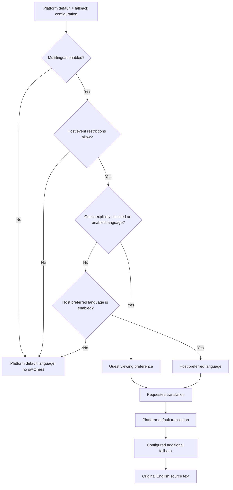

# Platform localisation — language hierarchy and controlled rollout

Implementation baseline: 2026-11-02. This extends the celebration/safeguard release. Localisation is **off by default**. Existing English flows remain the default until an administrator changes the platform settings. This is language support, not currency conversion, automatic translation of customer content, or provider-delivery certification.

## Supported language metadata

| Code | Native name | English name | Direction |
| --- | --- | --- | --- |
| en | English | English | LTR |
| ta | தமிழ் | Tamil | LTR |
| hi | हिन्दी | Hindi | LTR |
| ml | മലയാളം | Malayalam | LTR |
| kn | ಕನ್ನಡ | Kannada | LTR |
| te | తెలుగు | Telugu | LTR |
| es | Español | Spanish | LTR |
| ar | العربية | Arabic | RTL |

An administrator can add further canonical BCP 47 languages and their native names/direction as database records. Language identifiers are not a Java/TypeScript enum. The i18next diagnostic language `cimode` is reserved and cannot be enabled through language management.

Starter translations cover common navigation, forms, actions and verification messages. They are **not complete, native-reviewed language packs**. The translation workspace shows source and published-message counts. Missing entries fall back predictably; enabling a language does not certify every sentence has been translated. Native-speaker, payment-copy and RTL/device acceptance remain in the final production gap register.

## Preference and fallback rules

Host dashboard/settings use the authenticated account’s stored preference. Published event and group invitation pages default to the event owner’s preference. A guest override never updates the host’s account. Guests can select an enabled language without registration. The browser remembers a guest choice in local storage and a non-secret SameSite cookie, with graceful degradation when storage is unavailable. Malformed stored values are ignored. A host’s preference is stored server-side and can change without login/session rotation.

Host/event controls inherit platform availability by default. A host denial also denies its events; an event allow cannot override a host denial or the global off switch. Administrators retain access to global settings. Disabled language preferences remain stored but resolve to the platform default, allowing later reactivation without deleting preferences/content.

Text fallback is requested language → platform default → configured additional fallback → original source. The original source remains available even if English is hidden from the language selector. Published translations only are served to normal users. Drafts remain admin-only. Unpublishing removes a cached client translation on refresh instead of leaving an old published value in memory.

## Host and guest screens

- **Host → Account → Preferred language:** select an enabled language. The setting changes the dashboard, navigation/forms and defaults for guest pages and generated event communications.
- **Language bar:** appears across guest/account/admin pages only when multilingual support is effective. Options use native language names. Account changes persist to the authenticated account; guest changes persist independently in the browser.
- **Guest event/group pages:** inherit the event host’s preference on a first visit; an explicit guest choice takes precedence for viewing.
- **RTL:** the document `lang` and `dir` follow selected language metadata. Layout supports RTL direction; email, URL, phone, password/code fields preserve a practical LTR input direction. Native-language visual/accessibility review is still required.

React components subscribe to language changes; the application does not remount the page or recreate a login to switch languages. Source transformations target interface text and known feedback/labels. Input values, names, descriptions, wishes, account details, URLs, identifiers, monetary data, business comparisons and payment references retain their existing values.

Host-authored titles, descriptions, wishes, custom message templates and already-rendered invitation images remain as authored. No machine-translation provider is called. Language selection does not regenerate a published invitation/QR, convert currency, change payment status, or declare an unverified transfer verified. Dates/currency display can follow the viewing locale while keeping the original currency and numeric data.

## Administrator workflow

Open **Admin → Languages**:

1. Choose the platform default and additional fallback, enable multilingual mode, and save.
2. Enable/disable language records. A configured default/fallback cannot be disabled until another enabled language is selected.
3. Add a language using code, native name, English name and LTR/RTL direction.
4. Select a translation target; search source text/keys; edit plain-text messages and publish reviewed entries.
5. Export translation JSON for review. Import edited entries as drafts or explicitly publish a reviewed file. Imports validate keys, lengths, versions and placeholders and commit atomically.
6. Configure approved MSG91 language-template IDs where the provider supports them. This does not register/approve a sender or template with the provider.
7. Use advanced source-phrase registration for interface text already routed through the framework. Sources are public: never enter contacts, account details or private customer/event content.

Host restrictions appear under **Hosts & privileges → selected host → Language access**; event restrictions appear under **Recent events → Language access**. States are `INHERIT`, `ENABLED`, `DISABLED`. Existing preferences/translations remain when access is denied. UI/catalogues refresh on focus/visibility and after administrative changes in the same browser; remote configuration changes do not imply a WebSocket broadcast.

## Field and validation contract

| Object / fields | Rules / mapping |
| --- | --- |
| Settings `enabled`, `defaultLanguage`, `fallbackLanguage`, `version` | Required boolean; enabled language codes ≤63; version ≥0; singleton `platform_localization_settings` |
| Language `code` | Canonical BCP 47, ≤63; reserved diagnostic code rejected; `platform_languages.code` PK |
| Language `nativeName`, `englishName` | Required, ≤120; rendered as text |
| Language `direction`, `enabled`, `version` | `LTR`/`RTL`, required boolean, nonnegative optimistic version |
| Preference `language` | Required enabled code ≤63; user identity comes from session; `user_language_preferences` |
| Scope `state` | Required `INHERIT`/`ENABLED`/`DISABLED`; whitelist-controlled host/event table names |
| Translation `text`, `published`, `version` | Required plain text ≤10,000; explicit publish boolean; nonnegative version; key must exist |
| Interpolation | Every named `{{placeholder}}` in source must be preserved; unsupported formatting expressions/added or missing variables rejected |
| Translation search/page | Search ≤200; offset 0–100,000; limit 1–100; defaults 0/50 |
| Import `entries`, `publish` | ≤2,000 entries; explicit publish decision; each key/version/text validated; UI file limit 2 MB |
| Source registration `text` | Required, ≤10,000; stable SHA-256-derived UI key; UI category only |
| SMS template `templateId`, `version` | Required provider ID matching `[A-Za-z0-9_-]{1,120}`; optimistic version; private admin metadata |

Settings, language and translation edits reject stale versions with 409. Role/CSRF protections are retained. Unknown/inaccessible event references return 404. A missing translation returns fallback text rather than a blank control or message key. Native names/draft strings are never interpreted as executable HTML.

## API additions

| Method | Endpoint | Boundary |
| --- | --- | --- |
| GET | `/api/public/localization/catalog?token={optional-event-token}&language={optional-code}` | Public; published event required when token supplied; no private host fields or draft translations |
| GET | `/api/localization/catalog` | Authenticated account preference/catalogue |
| GET / POST | `/api/auth/language` | Own stored preference; POST requires authentication, CSRF and effective multilingual access |
| GET / PUT | `/api/admin/localization` | Platform admin settings; PUT optimistic version + CSRF |
| PUT | `/api/admin/localization/languages/{code}` | Add/update supported-language metadata |
| GET | `/api/admin/localization/translations` | Private paginated source/translation workspace and counts |
| PUT | `/api/admin/localization/translations/{language}/{key}` | Draft/publish a versioned translation |
| GET | `/api/admin/localization/translations/{language}/export` | Admin translation JSON export |
| POST | `/api/admin/localization/translations/{language}/import` | Atomic reviewed/draft import with per-entry versions |
| GET / PUT | `/api/admin/localization/scopes/{HOST|EVENT}/{id}` | Admin parent-bounded access control |
| GET | `/api/admin/localization/delivery-templates` | Private provider-template metadata |
| PUT | `/api/admin/localization/delivery-templates/{language}` | Approved MSG91 language-template association |
| POST | `/api/admin/localization/sources` | Register public UI source phrase |

Catalogue, preference, administration and export responses are no-store. Guest locale values cannot grant authorization, change actor identity, rotate payment references or bypass feature controls. The language cookie/header is a display preference and is not authentication evidence.

## Communications

Resend security-email subjects/bodies and SNS verification SMS use the localisation service with the request’s resolved locale. OTP values remain unchanged. MSG91 sends the raw code through an approved language-specific provider template; absence of a language template follows platform/additional/provider fallback. Existing provider availability/acceptance/error handling remains in force.

Manual-transfer notifications record the selected event-host language at enqueue time. Code-owned default thank-you/host notification templates use structured named variables; customer names and amounts are not inferred by splitting rendered financial text. Custom host templates remain as written. A selected language marker can accompany fallback text; it is not proof that every segment is translated. `PENDING` in the outbox still means not delivered. This release does not implement a universal notification dispatcher or certify SMS/email regional delivery.

## Implementation and operations

Flyway V97 adds language metadata/settings/preferences, source/draft/published translations, host/event controls, private language-delivery-template associations, and an outbox language column. Deactivation preserves rows. Startup registers versioned code-owned source messages and inserts starter translations only if absent; it does not overwrite admin edits. Retired source keys are retained rather than automatically deleting translations.

Frontend uses i18next/react-i18next with plain-text interpolation, non-suspending subscriptions and dynamic server resources. Source-preserving tools are `tooling/localize-frontend.cjs` and `tooling/localization-completeness.cjs`; extraction reports live in the documentation catalogue. Review semantic/rendered coverage instead of treating source extraction as native-language UAT. Framework documentation: [react-i18next hook](https://react.i18next.com/latest/usetranslation-hook), [i18next configuration](https://www.i18next.com/overview/configuration-options).

Compatible security maintenance updates Next.js to the patched 15.5 line and overrides PostCSS within version 8. The npm audit passed with zero reported vulnerabilities at the inspected lockfile; this is not a permanent or independent security certification. [Next.js advisory](https://github.com/advisories/GHSA-2464-fhr4-w9xw)

Current dedicated evidence: 13 localisation integration cases pass; frontend 405 tests, TypeScript and production build pass. Remaining backend release checks, catalogue refresh and native/browser acceptance are recorded in the main production document as they complete. No live provider message or payment was sent to validate localisation.
